# Verb Room 0.3.0 user manual

[Українська версія](Manual_uk.md)

## Contents

1. [What Verb Room is](#overview)
2. [Quick start in REAPER](#quick-start)
3. [Interface tour](#interface)
4. [Rooms and materials](#rooms)
5. [Sources, the listener, and outputs](#sources)
6. [Controls and modes](#controls)
7. [Movement and paths](#movement) · [Motion modulation](#motion-modulation)
8. [Baking explained](#baking) · [Decision table](#bake-decision) · [Workflows](#bake-workflows) · [Statuses](#bake-status) · [Examples](#bake-examples) · [FAQ](#bake-faq)
9. [Presets and sharing](#presets)
10. [Settings and performance](#performance)
11. [Troubleshooting and known limits](#troubleshooting)
12. [Reporting problems](#reporting)
13. [Glossary](#glossary)

<a name="overview"></a>

## 1. What Verb Room is

Verb Room is a VST3 reverb that models sound in a room you draw, with sources and a listener you can move. **Physical** plays the modeled room and **Creative** adds controls for shaping its sound. Version 0.3.0 is a working alpha for Windows x64, macOS Universal (Apple silicon and Intel), and Linux x86_64 (classic interface only). Check the [project download page](https://bodzijun.github.io/sbp-verb-room/) for packages and the [cross-platform build guide](Cross_platform_builds_en.md) for experimental CI builds.

<a name="quick-start"></a>

## 2. Quick start in REAPER (10 minutes)

Close the host before installing or replacing the plug-in. Copy the entire **Verb Room.vst3** bundle to the appropriate directory.

| Platform | VST3 folder |
| --- | --- |
| Windows | `C:\Program Files\Common Files\VST3\` |
| macOS | `~/Library/Audio/Plug-Ins/VST3/` for your account or `/Library/Audio/Plug-Ins/VST3/` for all users |
| Linux | `~/.vst3/` |

1. Open REAPER, rescan VST3 plug-ins if needed, and add **Verb Room** as an FX on a new track. Use a separate bus so you can route one or more dry tracks into the room.
2. Start with a stereo bus. In the bus routing window set the track to **2 channels**. In the Verb Room FX pin connector, check that the first two input and output pins correspond to track channels 1 and 2. For a mono experiment, only the first plug-in input needs signal. Keep both output pins connected for stereo.
3. Choose a small room from the room preset menu. In **Sources**, select an existing source or press **+ Source**. For one dry clip, use **Mono**, set **In** to 1, and send the clip's track to bus channel 1. Check the source meter. If you want to audition only the room bus, disable the dry track's separate master/parent send while leaving its send to the bus active.
4. Select the source and then the **Listener** in the viewport. Place them apart inside the room. In **Settings**, pick **Stereo (ORTF)** or **Stereo (XY)**. Play the clip and check both the source and output meters. Try **Mix** and **Positioned dry** if you want to adjust the balance of modeled direct sound and reflections.
5. For more sources, give each send a destination range and set the source's **In** and **Format** to match. For example, two stereo sources can use 1/2 and 3/4 on a four-channel bus. Check the corresponding pins and keep the stereo output on 1/2. For a 32-group VSL preset use **64 track channels** and all 64 input pins, switch off **Keep I/O**, then load the preset and create the sends. The preset configures the plug-in. You create tracks, sends, and pin mappings in REAPER.

The steps below use the new interface. Windows needs **WebView2 Runtime** for it, and macOS uses system WKWebView. **Theme → Classic UI** switches editors. In the classic editor, **New UI** appears when the platform supports it. Launch the host with `VERB_UI=classic` to force the classic editor. See the [interface switching notes](Release_0.2.0_en.md).

<a name="interface"></a>

## 3. Interface tour

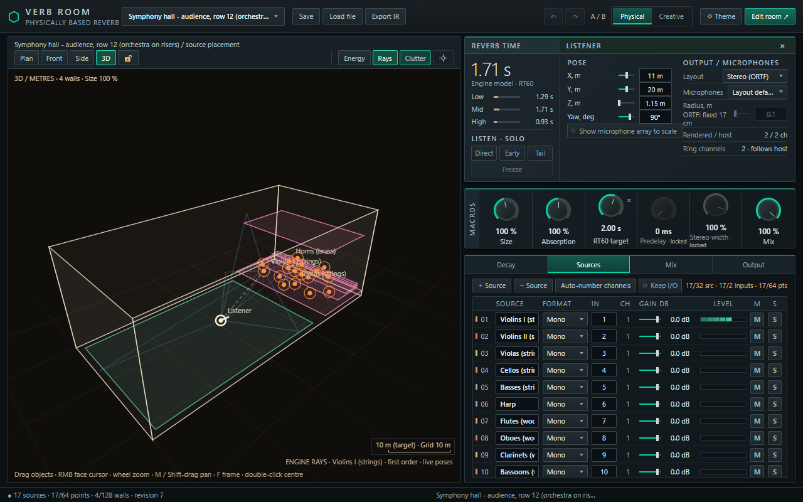

*Main page in the plug-in. The viewport is on the left and the selected object and sound controls are on the right.*

- **Header.** The room preset menu shows the current room. **Save**, **Load file**, and **Export IR** handle preset and impulse-response files. The arrow buttons undo and redo edits. **Physical** and **Creative** change how the sound controls are applied. **Theme** holds editor preferences, **About** (also available in **Edit room**) opens a dialog with the build version, recent highlights, quick tips, voluntary support options, and project links, and **Edit room** opens the geometry editor.
- **Viewport.** Switch among **Plan**, **Front**, **Side**, and **3D**. Use Plan for horizontal positions and Front or Side to check heights. The navigation menu has **Frame all**, **Frame sel.**, and **Lock pan**. The Main viewport also has its own lock button. If a drag has no effect, check the locks.
- **Overlays.** **Energy** opens the energy-map controls. Choose a source, slice height, octave band, and Direct/Early/Tail components, then analyze. The map estimates modeled coverage on that slice and leaves the audio unchanged. **Rays** shows direct/reflection paths. **Clutter** shows placed obstacles. **Paths** shows movement curves and nodes. See the [Energy analyzer guide](Energy_analyzer_0.1.14_en.md) for map interpretation.
- **Inspector and macro strip.** Select the source or listener to see position, orientation, and movement controls. The strip below the inspector contains **Size**, **Absorption**, **RT60 target**, **Predelay**, **Stereo width**, and **Output**.
- **Tabs.** **Decay** shows the seven modeled decay curves and the three creative decay controls. **Sources** is the input rack, including channel assignment and meters. **Mix** holds early/tail levels, diffusion, Doppler, wet/dry mix, makeup, and ducking. **Modulation** configures motion-driven modulation routes and shaping curves (Creative mode). **Settings** holds output layout, microphone controls, tail quality, and host-related options.

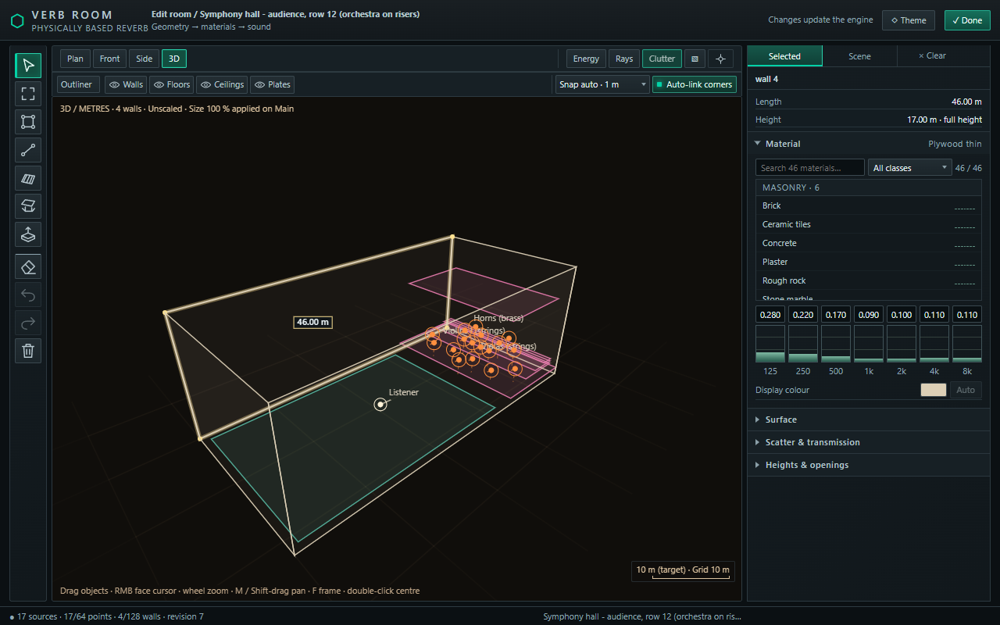

*Edit room in the plug-in. Use the tool rail to draw and the inspector to set surface properties and materials.*

**Edit room** has geometry tools, layer buttons, the **Outliner**, and an inspector. Select a surface to edit it, or choose **Scene** for room-wide settings. **Done** returns to the main page. Edits update the engine as you make them. The Outliner organizes surfaces by name and lets you select, hide, lock, and link them. Hidden surfaces still affect the sound. Surface links in the editor move geometry together. Movement **Groups** control the motion of sources and the listener.

<a name="rooms"></a>

## 4. Rooms and materials

For an enclosed room, start in **Plan**. Use **Draw rectangular room** to drag opposite corners, or **Add wall** to click the two ends of each segment. With **Auto-link corners** on, the next segment starts from the previous corner. Double-click to close the chain, or use Escape or right-click to end it.

Draw a patch with **Add floor zone** or **Add ceiling zone** by clicking its vertices and pressing Enter. These zones give areas of the base surfaces their own material. Use **Add raised plate** for a horizontal surface at its own height, such as a platform or canopy. Plates can reflect from both sides. Check the wall's bottom and top heights and the plate's height in the inspector and in **Front** or **Side**. In **Scene → Room**, set the base floor and ceiling and the room height. **Open sky (no ceiling)** is available for an intentionally open layout.

**Snap step** controls grid spacing for drawing and dragging individual corners. **Auto · follows grid** uses the visible grid step, a fixed step gives repeatable dimensions, and **Off** turns off the grid snap. Typed coordinates are exact. Use **Walls**, **Floors**, **Ceilings**, and **Plates** to cycle a layer through shown, locked, and hidden while editing.

Select a surface and use **Material** and its catalog to choose a starting material. Absorption is the fraction of energy absorbed in each of seven octave bands (125, 250, 500, 1,000, 2,000, 4,000, and 8,000 Hz). Transmission loss (TL) describes how much sound is lost passing through the material. A lower TL means more sound passes through. Pick a material appropriate to the intended surface and inspect its transmission before using it on a solid exterior wall. Material changes affect the sound and the bake.

In **Scene → Clutter**, set **Count**, **Min length** / **Max length**, **Min height** / **Max height**, and **Min TL** / **Max TL** for the generated obstacles. With the same scene and settings, **Seed** reproduces their placement. **Randomize** changes the seed. **Source clearance** keeps space around sources and the listener. Use the **Clutter** overlay to see the generated obstacles. In **Scene → Air**, set **Temperature** in °C and **Humidity** as relative humidity. The engine models air absorption across the same seven octave bands.

If a room is meant to be closed, check that every perimeter endpoint meets the next, including the last and first, without duplicated, crossing, or zero-length walls. Check the ceiling and look for unintended openings or wall height gaps. Inspect all source points and the listener above any platform and below the ceiling. An unjoined perimeter can make baking slow. Compare the response to a short impulse, check the decay and any abrupt changes, and reload the saved preset to confirm the result. See the [scene-authoring guide](Scene_authoring_agents_en.md).

### Joining corners

**Auto-link corners** moves already joined wall ends together when you drag a wall or a corner. In **Plan**, select a wall and drag an end near another visible corner to snap onto it. A wall or selection snaps when one of its moving wall ends approaches a stationary corner. The square marks the target and the preview shows the resulting geometry. The corner magnet works with **Snap off**. Hold Alt to bypass snapping, and use one Undo to restore the drag.

In **Scene → Room**, **Open corners** counts groups of wall ends with gaps under 10 cm. Choose a tolerance of 1, 5, or 10 cm and click **Join corners** to close those gaps in one edit. Gaps can leak sound and slow down **Bake path**. A locked wall can anchor a join. The command skips groups with conflicting locked ends, excessive spread, or a wall that would collapse. It repairs wall ends only. T-junctions along a wall and zone vertices require manual edits.

### Automation range

By default, host position automation parameters (`s1x..s32z` and `lx..lz`) span `−200…200 m` on X/Y and `0…30 m` on Z. For small or off-centre rooms you can narrow this per-instance range in **Edit room → Scene → Automation range** without changing parameter IDs or internal physics in metres:

- **Fit to scene:** Frames all walls, zones, active source extents, the listener array, and drawn path points / look-at targets with an automatic margin rounded to `0.5 m`. Switching away from the `±200 m` default asks for confirmation first, because changing the range rescales normalized host automation envelopes on that instance.
- **Manual Min / Max & Reset:** Enter custom bounds directly (minimum span `1.0 m` for X/Y and `0.5 m` for Z), or press **Reset (±200 m)** to restore global bounds. If a narrower range excludes active objects, a warning shows how many will be clamped; pressing **Undo** restores both the previous range and the exact pre-clamp coordinates in one step.
- **Viewport frame & persistence:** While **Automation range** is open in Edit room, **Plan**, **Front**, and **Side** views draw a dotted box showing the active bounds. Changing range without clamping any object keeps the audio engine output identical and does not invalidate **Bake path**. Non-default ranges are saved in DAW project states and `.verbroom` presets, unioned with local sources/paths under **Keep I/O**, scaled along with the room by **Scale room**, and reset to `±200 m` when loading plain `.txt` or built-in starter rooms.

<a name="sources"></a>

## 5. Sources, the listener, and outputs

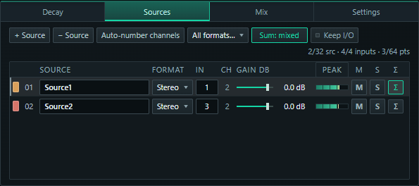

*Browser-harness capture with test routing. The first stereo source has Sum enabled, and the second does not.*

| Source control | What it does |
| --- | --- |
| **Format** | Input format for that source, including Mono, Stereo, LCR, Quad, 5.0, 5.1, 7.1, and Ring. |
| **In** / **Ch** | First input and number of input channels consumed. Stereo at **In** 3 uses channels 3 and 4. |
| **Gain dB**, **M**, **S** | Source gain, Mute, and Solo. Check both Solo and Mute when an input meters but is missing from the mix. |
| **Σ** / **Sum** | Combines a multichannel source into one engine point. It still takes the assigned input channels. For a mono source the switch is unavailable. |
| **All formats…** | Applies a format and renumbers inputs for sources that fit the channel and point budget. The rack reports any sources left unchanged. |
| **Sum for all sources** | Toggles Sum for multichannel sources. The button shows **Sum: all on**, **Sum: all off**, or **Sum: mixed**. Each bulk edit is one Undo. |
| **Keep I/O** | Keeps the local source configuration and output settings when loading a room. Pose and mix settings can still import by source index. |

The rack shows source, input, and point budgets and warns about overlapping routes. Verb Room supports up to 32 sources, 64 engine points, 64 inputs, and 16 outputs. Check the budgets after changing a format, a point layout, or a send. One stereo pair can be one logical source with two spatial points, or one point with **Sum** enabled.

### Directivity and aim

In the source inspector, choose a measured or modeled profile under **Instrument**, or choose **None (analytic)** and set **Directivity**. Built-in measured voice and speaker profiles are credited under CC BY 4.0. The selector also includes modeled instrument patterns. For your own measurements, use `verbdir_tool` to prepare a `.verbdir` file, then choose **Load .verbdir file…** in the profile selector. The Profiles folder is the default browsing location, and the last used folder is remembered. See the [converter guide](../tools/VerbDirConverter.md) and [directivity credits](../THIRD_PARTY_DIRECTIVITY.md).

Use **Profile amount** to blend from omnidirectional (0%) to the full profile (100%). The profile aim is a correction within the source orientation. Set it with **Aim azimuth**, **Aim elevation**, and **Aim roll**. Use the polar display to check which way the pattern faces. Measured profiles affect direct sound and early reflections. The late tracer treats sources with a measured profile as omnidirectional. The listener and its output array still have a position and direction.

### Listener and output routing

Select the listener to set its **X**, **Y**, **Z**, and **Yaw**. In **Settings → Output / microphones**, set **Layout** and check **Rendered / host**. Make room for the output channels in REAPER and route the pins to the track. Stereo layouts include ORTF and XY. Other layouts include Mono, 5.1, 7.1, and 7.1.4. The **Microphones** pattern and **Radius** depend on the layout. **Human ears** models ear spacing and head shadow.

| Output | Plug-in output channels | REAPER track channels for this output |
| --- | ---: | ---: |
| Mono / stereo | 1 / 2 | 2 |
| 5.1 / 7.1 / 7.1.4 | 6 / 8 / 12 | 6 / 8 / 12 |
| AmbiX (1st order) | 4 | 4 |
| AmbiX (2nd order) | 9 | 10 |
| AmbiX (3rd order) | 16 | 16 |

Use more track channels if the inputs need them. The Ambisonic layout fixes its microphone array. Match the decoder to **Ambisonics normalization** and give the track enough channels for the selected order.

| Ambisonics normalization | Channel order and gain |
|---|---|
| **SN3D** (default) | AmbiX, in ACN order with unattenuated W. |
| **N3D** | ACN order with each order \(n\) scaled by √(2n + 1). |
| **FuMa** | Legacy Furse–Malham order WXYZ RSTUV KLMNOPQ with MaxN weights and W at 1/√2. Missing components on a short track bus are silent. |

**Ambisonics level** attenuates every Ambisonic channel equally after normalization. Choose **0 dB** (default), **−3 dB** or **−6 dB**. Meter the decoded signal when comparing with stereo. Project state and room presets store both choices, **Keep I/O** preserves the local settings and IR export uses the selected order and gain.

<a name="controls"></a>

## 6. Controls and modes

**Physical** uses the room-derived decay and levels. **Creative** applies the saved overrides, including **Early level**, **Tail level**, **Doppler**, and the three **Decay by band** controls. **Low 125–250 Hz**, **Mid 500–2k Hz**, and **High 4k–8k Hz** shape groups of bands. The **Decay** graph displays seven modeled curves and estimated RT60 values. Extrapolated portions are estimates.

**Absorption** scales the room's absorption in either mode (0.3–3.0). For a time in seconds, set and press **RT60 target**. The assistant adjusts absorption toward the mid-band target (500 Hz–2 kHz). Check the achieved decay in the graph, especially when the requested value is outside what the modeled room can reach.

**Size** scales the room and poses at runtime and is available in both modes in this build. The **Scale room** action in Edit room changes geometry once. **Predelay**, **Stereo width**, **Duck** (**Amount** and **Release**), and **Freeze** are Creative controls. Predelay delays wet sound, Stereo width adjusts spatial width where available, Duck attenuates the reflected sound while input is present, and Freeze holds the tail. Switching into Physical leaves the saved overrides available for the next switch to Creative.

In **Mix**, **Positioned dry** makes the direct sound follow source and listener positions. With Positioned dry on, **Mix** sets the amount of reflected sound while keeping the modeled direct signal. With it off, Mix crossfades raw input and the modeled room. Under **Listen · solo**, use **Direct**, **Early**, and **Tail** to audition components, including combinations. **Output** controls the overall output gain, and **Makeup** adds gain. **Auto** sets Makeup from the last completed model, so stop moving first. Output meters read the final output.

### REAPER automation

The FX parameter list exposes **Mode**, **Size**, `absorption`, `decayLow`, `decayMid`, `decayHigh`, **Early Reflections**, **Tail Level**, **Early Diffusion**, **Doppler Strength**, **Predelay**, **Stereo width**, **Freeze**, **Duck amount**, **Duck release**, **Dry/Wet Mix**, **Positioned Dry**, **Solo Direct**, **Solo Early**, **Solo Tail**, **Output Gain**, and **Makeup**. It also exposes numbered source **Gain**, **Mute**, and **Solo**, plus the pose and path parameters described below. The mode determines which parameters affect the sound.

Room drawing, surface materials, source routing and profiles, output layout, tail quality, the **RT60 target** action, **Auto** makeup, and the bake buttons are editor commands. Automate the resulting **Makeup** or `absorption` parameter when you need an envelope for that value. To give DAW X/Y/Z envelopes finer lane resolution inside a specific room, configure **Edit room → Scene → Automation range**.

<a name="movement"></a>

## 7. Movement and paths

1. Select one source or the listener. Under **Path**, press **Draw path**. Click at least two points in the viewport and finish with Enter, a double-click, or **Drawing… (Finish)**. Escape cancels the draw. Use **Edit** to drag, insert, append, or remove points. Use **Clear** to remove the path and return to static XYZ.
2. Turn on **Enabled** to follow the path. **Closed** joins the end back to the start. **Smooth** curves through the points. With a closed path, **Laps** sets the number of circuits across the movement window.
3. Drag **Position** to check the movement. **Start %** and **End %** define the window within the 0–100% control range, with the object held at either end outside that window. Point **Time %** keys set when specific points are reached within the window. Easing shapes travel between points. The **Path timeline** button opens the timeline panel, where you can see windows, keys, and playheads together. Its horizontal axis is Position percent. Put the timing in seconds or beats on the REAPER envelope.
4. To couple paths, assign each enabled path to the same **Group** under **Coupling**. Each object keeps its own route, time window, and easing, and the group shares one **Position** driver. Read **Drives Group …** or **Driven by …** in the inspector. A follower's own Path position envelope does not drive the group.
5. Choose **Orientation**. **Manual** follows the source's **Azimuth** or listener's **Yaw**. **Along path** follows path direction, and **Look at** faces a source, the listener, or a fixed **Point…**. In the latter two modes the angle parameter adds an offset. **Profile aim** remains an additional adjustment for the source profile.

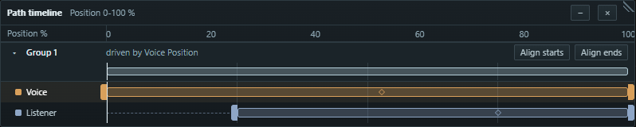

*Browser-harness capture with test paths. Voice (Source 1) drives Group 1, and the listener begins at 25% on the same Position axis.*

### Azimuth keys

Each moving source or listener (`points >= 2`) has an **Azimuth** sub-row under its path bar in **Path timeline** with an interactive −180…180° angle curve (wrapping seamlessly across ±180°). Azimuth keys apply only when **Orientation** is set to **Manual** and take priority over direct control of the object's **Azimuth** slider:

- **Add & edit keys:** Press **+ Key** to capture the current angle at the playhead, or double-click empty space on the Azimuth strip. Click a key marker to open the bottom **Angle** editor (slider or double-clicked readout; **Shift** gives 0.1° fine steps).
- **Timing, curves & removal:** Drag a key left/right between neighbours (**Shift** = 0.05 % fine snap) or nudge a focused marker with **Left/Right** arrows. Right-click a key for **Linear**, **Ease in**, **Ease out**, **Ease in-out**, **Hold** (stepped orientation), or **Delete key** (**Del** / **Backspace** also deletes). Every drag gesture records a single undo step.
- **Viewport rotation:** Right-dragging in **Plan** or **3D** updates only the selected key or a key within ±0.5 % of the playhead; rotating elsewhere without a selection leaves keys unchanged and shows a viewport hint. Objects with 0 keys still rotate their host **Azimuth** control directly.
- **Locked slider & other orientation modes:** With active keys in **Manual** mode, the inspector's **Azimuth** slider shows the interpolated angle as read-only (`Azimuth keys: N` + **Timeline** focus button). Switching to **Along path** or **Look at** dims the strip with a reminder and keeps your stored keys intact.

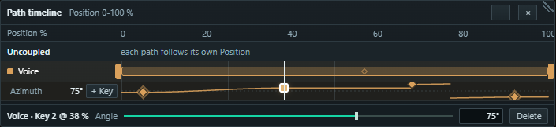

*Browser-harness capture of a moving Voice path with four Azimuth keys (Ease in-out, Hold, and ±180° wrap) and Key 2 selected in the Angle editor.*

### Draw the envelope in REAPER

Use the FX parameter list to show the envelope for **Source 1 Path position** (or the appropriate source number), or **Listener Path position** for an independent listener. For a Group, show only the driver's envelope. Set two points at the desired start and end times, with parameter values at the bottom and top of the range (0 to 1 in the plug-in parameter, or 0% to 100% on its Position display). Start with a linear ramp. Add flat sections before and after the ramp if you want to hold the endpoints.

Static source/listener **X**, **Y**, and **Z**, source **Azimuth**, and listener **Yaw** are also host parameters. An enabled path supplies XYZ from Position. Use static XYZ automation for movement without a drawn path. Path points, timing windows, easing, laps, group assignments, and orientation mode/target are edited in the plug-in. Use **Keep processing during silence** in **Settings** if Position automation must take effect before the first sound. This uses more CPU.

<a name="motion-modulation"></a>

### Motion modulation

In **Creative** mode (`Mode = Creative`), two additional modulation tools let scene motion shape audio dynamically: **Modulation routes** and **Path LFO**. Both are strictly **Creative-only**: switching back to **Physical** bypasses all modulation cleanly while preserving every route, curve, and LFO setting intact for when you return to **Creative**. Clear hints indicate this in the **Modulation** tab and **Path LFO** inspector.

#### Modulation routes (`Modulation` tab & floating editor)

Each route links a **Source object** (`Source 1..32` or **Listener**) and one of 11 spatial/motion **Drivers** to a per-source or global **Target**, shaped by a transfer curve and attack/release smoothing (up to 64 routes per instance):

- **Docked bottom editor & optional detach:** The full **Modulation** editor (toolbar with **+ Add route**, **Add from preset…**, route list on the left, interactive curve, node bar, ranges, and live telemetry on the right) lives right inside the bottom **Modulation** tab; drag the inspector/tabs splitter upward to give it extra room. Click **Detach ↗** (or the **Mod** toggle in the viewport toolbar, available in both **Main** and **Edit room**) to open the optional floating **Modulation editor** over the scene. When detached, the bottom tab displays the compact route list and **Dock ↙**; drag the floating header to move (double-click to reset), resize from the top-right grip, collapse (`−`), or press `Dock ↙` / `Mod` / `×` / `Esc` to dock back. Picking from **Add from preset…** always appends a new route (selecting it, briefly highlighting its row, and confirming `Added route: <Driver → Target>` in the status bar without overwriting the current route), and double-clicking a route selects it directly without popping up extra windows. Each route row clearly lists its full **Driver → Target**, object scope, explicit **Active / Off / Bypassed** status, and live target readout with units.

  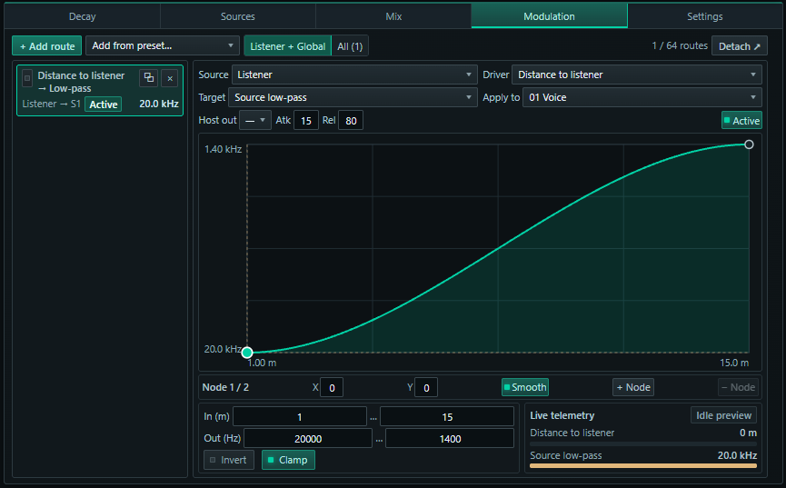

  *Docked **Modulation** tab showing a **Distance to listener → Low-pass** route (`In 1–15 m`, `Out 20000–1400 Hz`), its transfer curve, and live telemetry readout.*

- **11 drivers:** **Distance to listener**, **Distance to point** (with reference **X / Y / Z** fields), **Azimuth to listener** (relative to listener heading, ±180°), **Elevation angle**, world **X**, **Y**, **Z**, smoothed 3D **Speed**, signed **Radial speed** (away positive, toward negative), **Path position** (shown in ranges as **In (path 0–1)** = effective path progress 0..1 including Path LFO), and **Distance to nearest wall**.
- **8 targets & safe range/curve switching:** Per-source **Source gain Δ** (`-60..+12 dB`), **Source low-pass** (`20..20000 Hz`), **Source high-pass** (`20..20000 Hz`), **Source low shelf** (`-12..+12 dB`), and **Source high shelf** (`-12..+12 dB`), targeting the same or another source via **Apply to**; global **Early level Δ** (`-60..+6 dB`), **Tail level Δ** (`-48..+12 dB`), and **Wet / dry mix Δ** (`-100..+100 %`). Multiple routes on the same target sum in dB / % (or log₂ octaves for LPF/HPF). Output ranges clamp automatically to each target's legal domain; switching **Target** atomically resets output range and resets the curve to linear defaults in one Undo step, while switching **Driver** resets `Input range` to that driver's defaults.
- **Transfer curve, smoothing, and live readout:** Drag 2–8 nodes on the interactive curve graph (double-click empty plot or press **+ Node** to insert; **Del** or **− Node** removes; one drag gesture records a single undo step). Toggle **Smooth** per segment, edit numeric **Node X / Y**, **In / Out** ranges, **Invert**, **Clamp**, **Atk ms** (0–2000 ms), and **Rel ms** (0–5000 ms). The **Live telemetry** panel and moving crosshair below the curve show the real-time driver and output target values.

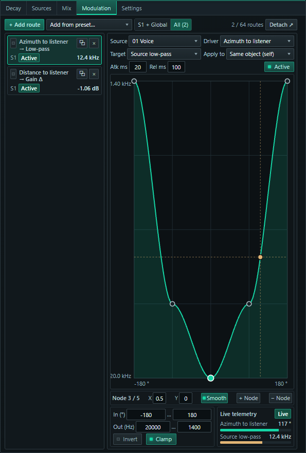

*Detached floating Modulation panel showing two active routes, a 5-node curve, and live driver/target telemetry.*

#### Path LFO

Moving paths (`points >= 2`) include **Path LFO** controls in the source or listener path inspector alongside **Position** and **Coupling**:

- Toggle **Path LFO** and choose **Shape** (`Sine`, `Triangle`, `Saw`, `Square`, `Smooth random`), **Rate** (`0.05–8 Hz`), **Depth** (`0–100 %` of path range), and **Phase** (`0–360°`).
- **Swing & end-of-path safety:** **Path LFO** modulates around the **Position** slider (`Swing a–b %`). When swing crosses `0 %` or `100 %`, a live warning explains boundary behavior (**Closed** paths wrap around `[0, 100%)`, whereas open paths clamp at `0 %` and `100 %`), and a **Keep inside path** button clamps **Depth** cleanly to the largest integer percentage that fits inside `[0 %, 100 %]`. Path LFO follows host transport playback (standing at phase `0°` when stopped, or free-running in offline/standalone renders without transport).
- **Base path & Bake compatibility:** The viewport always displays the **base path geometry** (the Path timeline highlights the oscillation range around the playhead). Enabling or adjusting Path LFO does **not** alter path geometry and leaves an existing **Baked** table valid.

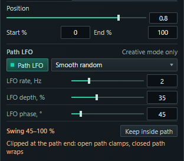

*Browser-harness capture in Edit room showing Path LFO controls (Smooth random, rate, depth, phase), live Swing readout, boundary warning, and Keep inside path button.*

#### Using modulation in other plug-ins

Every modulation route in **Creative** mode includes an optional **Host out** slot (`—` or `1`–`16`), corresponding to the sixteen automatable host parameters **`Mod Out 1`** … **`Mod Out 16`** exposed at the end of Verb Room’s parameter list (listed like any normal parameter so DAWs such as REAPER allow linking to them):

- **Target options:** Pick any internal Verb Room target to modulate both Verb Room and a host slot at once, or set **Target** to **Host output only** (`none`) when you want a pure external modulation curve without altering Verb Room’s own sound.
- **Output format & modes:** Each active slot outputs the route’s **smoothed curve in normalized `0–1` range** (before target-range scaling), clamped to `[0, 1]` and updated once per audio block when changed by more than `1e-4` (with up to one block of latency relative to track effects before or after Verb Room). If multiple enabled routes target the same slot, the last enabled route in the list wins. Switching back to **Physical** mode returns all `Mod Out 1–16` parameters smoothly to their neutral **`0.5`** value.
- **Do not draw automation on `Mod Out 1–16`:** Although `Mod Out 1–16` appear in parameter and envelope lists so hosts can link to them, they are **outputs driven only by Verb Room’s modulation matrix**. Writing host automation envelopes or manually moving `Mod Out` controls is **ignored** and has no effect.
- **REAPER setup (`Link from FX parameter`):**
  1. Insert Verb Room in **Creative** mode and add a route (e.g., **Distance to listener → Host output only**, **Host out** = `1`).
  2. Open another FX before or after Verb Room on the track (or route across track FX in REAPER), click the target parameter’s **Param** button → **Parameter modulation / MIDI link**.
  3. Enable **Link from FX parameter**, pick **Verb Room** → **`Mod Out 1`**, and adjust offset/scale as needed.

#### Known limits

- Rate is specified exclusively in hertz (**Hz**); **host-tempo sync** (musical divisions) is not implemented.
- **Classic UI** does not expose the modulation matrix or Path LFO controls; use the web editor to configure them.

<a name="baking"></a>

## 8. Baking explained

**Bake path**, in the **Bake late tail** row, precomputes a late-tail table so the reverb follows movement as it happens. For supported drawn paths, press **Bake path** directly. For movement driven by REAPER, use **Record automation** in the **Host automation** row, play the movement once, press **Stop**, then press **Bake path**.

### What you hear

Direct sound and early reflections already follow the live poses. The late tail costs more to trace, so during motion the plug-in estimates it using the existing tail. When the poses stay steady for about **0.4 seconds**, the engine schedules one accurate rebuild for the settled pose. The rebuild and transition take additional time. Without a bake, the tail during movement can differ audibly from the final settled tail.

With a bake, the plug-in traces samples along the movement ahead of time and uses their table to guide the late-tail estimate during matching playback. You can hear the tail follow the route before the objects stop. There is still a transition to the accurate tail at the settled pose.

<a name="bake-decision"></a>

### Do I need to bake, and how?

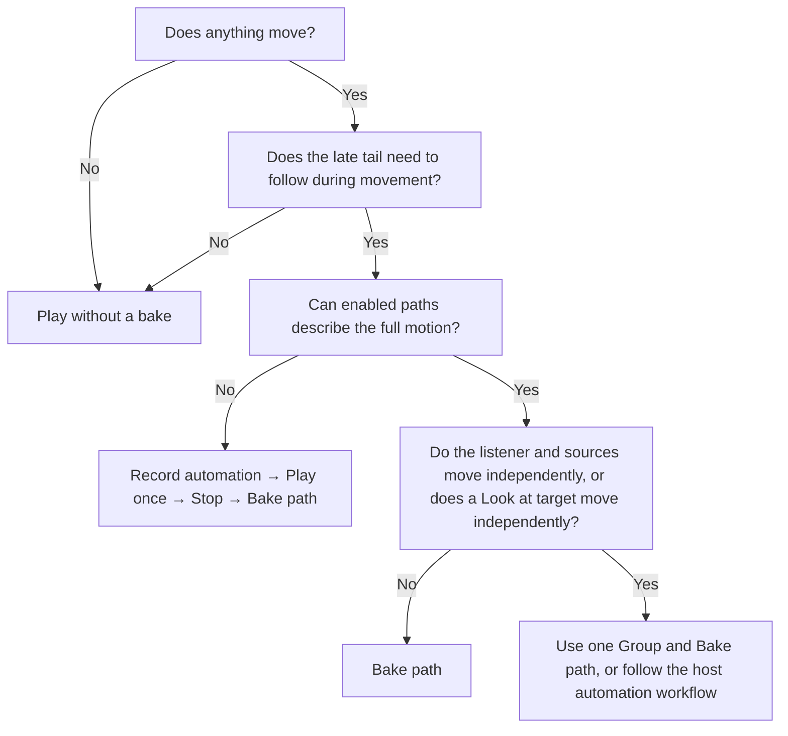

| My situation | What to do |
| --- | --- |
| Nothing moves, or the live estimate sounds fine | Play without baking. Let a static pose settle. |
| One source moves on a drawn path | Enable it and press **Bake path**. |
| Several sources move on independent paths and the listener stays put | Enable the paths and press **Bake path**. The bake can compute tables for independent sources. |
| Only the listener moves on a drawn path | Enable it and press **Bake path**. |
| The listener and sources move together | Put all moving paths in one **Group**, automate its driver, and press **Bake path**. |
| The listener moves while sources move on independent paths | Put every moving path in one **Group** and bake, or follow the host automation workflow below. |
| Motion comes from REAPER XYZ or angle envelopes alone | Use **Record automation**, play once, press **Stop**, then **Bake path**. Replay the same movement. |
| A moving object's **Look at** target moves independently | Put both paths in one **Group** and bake, or follow the host automation workflow below. |
| A moving **Manual** object also has angle automation | Bake the path/group, or bake a recording for independently driven motion. Without azimuth keys, a changing live manual angle does not drop the table (direct and early sound still turn live); with active azimuth keys, the key curve is baked into the table. |
| AmbiX or a large scene | Choose the workflow by how objects move. Allow more time for tracing, especially with more sources, outputs, or rays. |

<a name="bake-workflows"></a>

### Bake drawn paths

1. Draw and enable each path. If the listener and one or more sources move, give every moving path the same **Group**. Set the movement windows, easing, and orientation. Set up the REAPER envelope for the independent path or Group driver, then check the motion with **Position**.
2. Stop playback and finish editing. Set the layout and tail quality you intend to use. Press **Bake path** in a moving object's **Path** section.
3. Wait while the bake progresses. **Baked** means the table is ready. **Baked (approx.)** also has a usable table, with intervals outside the error tolerance.
4. Play the passage and check **Tail** under **Listen · solo** while the objects move. Return to the full mix afterward.

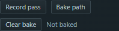

*Browser-harness capture before baking an independent drawn path. Use Bake path in the Bake late tail row.*

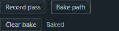

*Browser-harness capture after a simulated bake of the drawn path.*

### Record a REAPER pass, then bake it

Use this when live host automation supplies the movement, or when the moving listener or a moving Look at target cannot use the same Group. **Bake source** shows what **Bake path** will use. Bakeable drawn paths take priority. The recording is used when drawn paths are blocked or absent. For a pass driven by XYZ or angle alone, disable competing drawn paths. The recorder can capture angle-only changes. Check **Tail** after baking to hear how closely it follows a Manual turn. Keep independently moving paths enabled when REAPER drives those paths during recording.

1. Park REAPER just before the movement. In the source or listener **Path** section, press **Record automation** in the **Host automation** row. The button changes to **Armed - Stop**.
2. Press Play in REAPER. Run through the movement once, with the plug-in receiving processing blocks. The button shows **Recording N - Stop** as pose samples accumulate.
3. At the end press the plug-in's **Stop** on that same recording button. Stop REAPER and check for **Recorded N - Record again**.
4. Check **Bake source** for `recorded automation (N samples)`. The highlighted `Recorded - now press Bake path to compute the tail` means the capture is ready. Press **Bake path** (or **Bake again** if shown) in the **Bake late tail** row and wait for **Baked** or **Baked (approx.)**.
5. Return to the start and play the same envelopes and movement. If you change the route or relative timing used in the pass, use **Record again**, play it through, and bake the new recording.

### After an edit, saving, or stopping a job

| What changed | What to do |
| --- | --- |
| Room geometry, materials, absorption/size, output layout, or tail quality | An affected table can become **Outdated**. Finish the edits and press **Bake again** for the new room and settings. Re-record if the actual captured poses or motion have changed. |
| Drawn path, timing window, key, laps, Group, or orientation setup | Check the new movement and press **Bake again** if its table is outdated. |
| Source set, point layout, or stationary participants in the baked context | Check the new routing/poses. Re-bake affected paths. Capture the pass again if its source set or motion no longer matches. |
| REAPER envelope for Position only | Timing the same drawn motion against the song can reuse the table. For a recorded pass, re-record if the sequence of poses no longer matches. |
| Live angle in **Manual** on a moving path | Playback can keep using the table. A drawn bake samples Manual at the angle used when requested. A recorded bake uses captured angles. Re-bake or re-record if you want different angles represented in the table. |
| Undo or reuse an earlier room/path configuration | A compatible table can return from cache. Check the displayed status before baking again. |

**Cancel** stops the ongoing bake. **Clear bake** discards all baked tables and keeps the drawn paths and recording. **Discard** (in the Host automation row) stops any armed or ongoing capture, discards the recorded automation, and removes any bake made from it. Drawn-path bakes are preserved by **Discard**. **Bake again** computes a replacement for the current scene and movement. **Clear** in the draw controls removes the selected path.

A project can restore a matching baked table and its recorded pass. A `.verbroom` can restore compatible tables for drawn paths. Share the project when the recipe depends on a recorded pass, because `.verbroom` omits the captured poses. A table that is too large to store, a table for a different context, or an earlier table for a moving Manual participant may need to be baked again. Tables from 0.2.0 always need one fresh bake. Check the status after reopening.

<a name="bake-status"></a>

### Bake and recording messages

The inspector shows the path state. The footer adds job-wide progress and reasons. Names, percentages, and counts vary with the scene.

| Inspector or footer text | Meaning and action |
| --- | --- |
| `Not baked` | No usable table for this path. Play as-is or press **Bake path**. |
| `Baking N %` / `Baking path · NAME · N %` | The request is active. Wait for the reason or progress to change, or press **Cancel**. |
| `Tracing stations - D/T stations` / `Refining path - D/T stations` | The worker is tracing sample poses or refining intervals. It can spend time at a single count. |
| `Baked` / `Path baked` / `NAME baked` | The table is current. Play the motion. |
| `Baked (approx.)` / `Path baked (approx.)` / `N intervals above tolerance` / `Some intervals exceed tolerance` | The table is usable, with some intervals above tolerance. Listen through the transitions. |
| `Look at path sampling relaxed xN (station cap)` | Sampling a Look at path reached the station budget. Listen to the sections with rapid turning. |
| `restored from the saved project` / `restored after undo` | A matching saved or cached table was recovered. Check the status and play. |
| `bake not stored: too large` | The current table can be used in this session. Expect to bake again if the project or preset cannot store it. |
| `Outdated` / `Room, quality or path changed - bake again` / `Room, quality or recorded pass changed - bake again` / `Path needs a new bake` | The table no longer matches the current setup. Finish the edits, then bake again. |
| `Not baked · Cancelled` / `Not baked · Cancelled · Cancelled` / `Path bake cancelled` | The job stopped at your request. Start a fresh bake when ready. |
| `A room is loading` | The room is still loading, so the command is unavailable. Wait for the room to finish loading and try again. |
| `Cannot bake` | The requested motion needs a valid path setup or a recording. Read the reason below. |
| `Enable a path or record a pass before baking` | Enable a path with at least two points, or capture a usable pass. |
| `Cannot bake uncoupled moving listener with sources - assign them to one Group or record a pass` | The listener moves independently and other paths move too. Group every moving path or record the pass. |
| `Cannot bake uncoupled paths alongside a moving listener - couple all moving paths in one Group or record a pass` | The listener is grouped but some other moving paths are outside that group. Group them all or record the pass. |
| `Look at target moves independently: OWNER looks at TARGET; put both paths in one Group or record a pass` | The target has independent motion that the drawn bake cannot represent. Couple them or record. |
| `Bake failed` / `Bake failed - resource or tracing error` | The job could not finish tracing or allocating resources. Try again with a smaller ray budget or scene. Include the reason if it recurs. |
| `Late energy unavailable - bake could not finish` | Tracing did not supply usable late energy for the table. Check room geometry, heights, and source/listener placement. |
| `Bake source: drawn paths (Group N)` / `Bake source: drawn paths (independent)` | Bake will use the enabled paths, as a single named group or as independent bake groups. |
| `Bake source: recorded automation (N samples)` / `Bake source: nothing to bake` | Bake will use the capture in the first case. In the second, draw a supported path or record automation. |
| `Recording kept, not used: drawn paths are baked instead. Press Discard if you do not need it.` | The capture is still saved with the project. Bake uses the drawn paths. |
| `Live motion is outside the baked recording - estimating the tail` | Current poses fall outside the baked recording's coverage. The live estimator takes over there. Replay the original motion or record it again. |
| `Recorded - now press Bake path to compute the tail` | A recording is ready and selected as the bake source. Start the bake manually. |
| `Armed - Stop` | The recorder is armed. Start playback to capture motion, or press its Stop to cancel. |
| `Recording N - Stop` | Poses are being captured. Press the plug-in's Stop at the end of the movement. |
| `Recorded N - Record again` | A capture exists. Check **Bake source** before baking it, or click the recording button to replace it. |

| Waiting message | Meaning and action |
| --- | --- |
| `Updating the tail after a timeline jump` | The engine is handling a seek. Leave the playhead in place and wait. |
| `Rebuilding the room` | The editor or quality change is still being applied, or the ordinary tail rebuild has priority. Finish edits and wait. |
| `Updating the tail for settled poses` | The ordinary rebuild is updating the reference tail for the settled poses. Wait for it to finish. |
| `Waiting for listener and source poses to settle` | A pose needed for the bake is changing. Stop scrubbing or moving objects and give them a moment to settle. |
| `Waiting for poses at the new room size` | A Size change is waiting for poses at the applied scale. Let the change finish. If this specific message persists with the transport stopped, briefly run playback so the host supplies fresh poses, settle, and retry if needed. |
| `Waiting for settled rebuild` / `Waiting for poses to settle` | Earlier-build wording. In 0.2.2 the footer gives the more specific messages above. After a room edit or replacement, the stopped-host bake should complete without needing Play. |

Large rooms can take **about 1–2 minutes on the development machine**. One measured bake finished in about 111 seconds. Time varies with scene complexity, quality, output layout, CPU, and background load. The worker pool runs at lower priority. Leave the scene still and keep other CPU-heavy jobs quiet while you wait.

<a name="bake-examples"></a>

### Worked examples

These are practice setups. Distances and times are example values. The browser figures illustrate the corresponding controls and axis.

1. **Car past a building.** Place a mono engine track on input 1. In a building-side scene, use Plan and mark three points along the road at roughly 0, 6, and 12 m from the start, at a height of 1 m. Keep the listener still near the facade. Use **Enabled**, leave **Closed** off, and automate **Source 1 Path position** from 0% to 100% over three seconds. Use [the idle controls shown above](#bake-workflows) to press **Bake path**, wait for **Baked**, then compare **Tail** under **Listen · solo** over the approach and departure.

   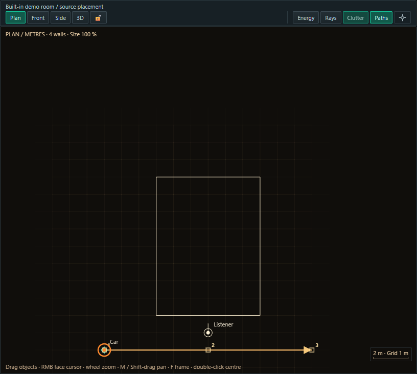

   *Browser-harness capture with test geometry. The car follows the orange path and the listener is placed at the facade.*

2. **From podium to row 6.** Load the VSL Grand Hall Conductor preset for the starting perspective and leave the stage sources still. Draw a listener path from the podium to a spot in the audience area that you choose. "Row 6" is only an illustration: the presets contain no seats or numbered rows. For example, use three points, a starting ear height of 1.9 m, a seated endpoint of 1.2 m, and a five-second **Listener Path position** ramp. Check the scene's actual heights and choose a route clear of surfaces. Select each node to enter its Z height in the path editor. The separate Audience preset gives a fixed audience perspective. Bake the single listener path after the output layout and routing are set.

   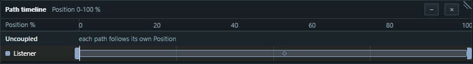

   *Browser-harness capture of the three-point listener example on test geometry. The timeline shows Position, and the five-second ramp belongs in REAPER.*

3. **Walking voice and listener.** Give the voice three points over about 4 m and the listener three over about 3 m. Put both enabled paths in **Group 1**, set the listener's **Start %** to 25, and keep **End %** at 100. With the voice as Source 1, its Path position drives both. Ramp it over four seconds. Choose **Manual**, select **Human Voice · Sentence (TH Köln)** in **Instrument**, and automate **Source 1 Azimuth** from −30° to +60°. Bake the Group and compare the **Tail**, **Direct**, and **Early** solos separately. The live turn is heard through the direct and early components.

   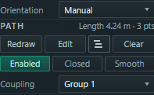

   *Browser-harness capture with test paths. Compare the distinct starts in the [Group timeline figure](#movement).*

4. **Record DAW automation.** Disable the path for a mono source and automate **Source 1 X** from 1 m to 5 m over two seconds with Y and Z held constant. Give the listener its own independent Y envelope if desired. Press **Record automation**, play the envelopes once, then press the plug-in's **Stop**. Check the highlighted hint and press **Bake path**. Replay the same envelopes. If you change them, check for `Live motion is outside the baked recording - estimating the tail`.

<a name="bake-faq"></a>

### Baking FAQ

- **Bake does nothing or stays at 0%.** Read the reason. Check that a path is enabled or that **Recorded** shows a usable pass. Finish room edits, stop scrubbing, and wait for the rebuild. Since 0.2.3 a room edit or replacement can bake with transport stopped. If a small, closed room never starts tracing, report the exact banner and the edits that preceded it.
- **Outdated all the time.** Check for live changes to geometry, size, absorption, quality, route, or stationary participants. Choose the final settings before baking. Check for a table from an earlier build after opening a project or preset. For a recording, verify that the pass still represents the motion.
- **The tail changes when movement stops.** One accurate rebuild at the settled position is expected. In a development test of one scene, the broadband change was about **+0.4 dB** with either bake workflow and **−8.6 dB** without one. Those values describe that scene and measurement. A conspicuous change with Bake warrants checking table use and the recorded-pass status.
- **The baked tail ignores my azimuth turn.** Without azimuth keys, the table uses the angle sampled when baking a drawn path (or captured during a recorded pass) while direct and early sound turn live, so changing the Manual angle does not drop the table. To make the baked tail follow planned turns on a drawn path, add **Azimuth keys** before baking.
- **Baking is very slow.** Bake time grows with the size of the room. In practice, rooms assembled from overlapping or unjoined volumes take noticeably longer, so check that a room intended to be enclosed has joined corners and no unintended openings. Large scenes, high ray budgets, many outputs, and background CPU load can all increase the wait. Try **Preview** quality while checking the setup and bake at the final quality for the mix.
- **How do I clear or replace a bake or a recording?** **Discard** removes the capture and its bake. **Clear bake** clears tables and keeps paths and the recording. **Cancel** stops a running bake. **Bake again** computes a new table after an edit.
- **Do I have to bake?** For a static room, play it normally. For motion, listen to the live estimate and bake when the late tail needs to track the passage more closely.

<a name="presets"></a>

## 9. Presets and sharing

Use **Save** to make a complete `.verbroom`, and **Load file** to open one. The file contains geometry, materials, source and listener settings, paths, mix parameters, output setup, tail quality, and eligible baked tables. The user library is in the Documents folder under `SBP/Verb Room/Rooms`. Saved presets appear in the room menu. The host project holds your sends, pin assignments, tracks, envelopes, and any instrument instances you set up. Sample libraries are supplied separately.

Built-in choices include **Chamber hall - audience, row 6 (chamber orchestra)** and VSL Grand Hall presets for **audience** and **conductor**. The downloadable packages also include the VSL Grand Hall Audience and Conductor preset files. Both use 32 stereo groups over inputs 1–64, with the same hall and different listener viewpoints. Turn **Keep I/O** off to load the full routing. Leave it on to try another room with your current source formats, assignments, and output layout. Poses and mix settings import by source index. See the [preset guide](Presets_0.1.10_en.md) and [orchestra routing notes](Orchestra_presets.md).

**Load file** also accepts older `.txt` scenes. They describe geometry. Set up sources, routing, and mix in the plug-in and save as `.verbroom` for complete exchange. Older `.verbroom` files and saved projects still load. Check the bake status after loading and remember that reselecting a built-in room brings in that version's defaults. Before sharing, check for unintended **Mute** or Solo states and test the preset in a fresh instance.

**Export IR** generates static 32-bit float WAV impulse responses, one file per engine point, and a text description of the room. Use the listener and source positions you want before exporting. This is a snapshot of the modeled response and the export excludes LFE. Save a preset or project to share editable motion.

<a name="performance"></a>

## 10. Settings and performance

- **Output / microphones** contains **Layout**, **Microphones**, **Show microphone array to scale**, and **Radius**. Check **Rendered / host** and the output meters when setting up surround.
- **Tail · convolution** contains **Quality**, **Tail rays**, and **Adaptive**. **Preview · 12,000**, **Mix · 48,000**, and **Render · 192,000** set the base ray budget. **Tail rays** sets it manually (8,000–384,000). With any other value the **Quality** menu shows **Custom**. **Adaptive** allows bounded refinement. Changes in quality can invalidate a bake.
- **Physics** has **Edge diffraction**. The **Array / host** column has **Keep processing during silence**, which is off by default. REAPER can stop calling a silent plug-in after the reported tail. An alternative is the plug-in's REAPER **Compatibility settings → Ignore plug-in reported tail size**.
- **Theme** has **Accent**, **Background tint**, **Tint strength**, viewport palettes and per-element colors, an **Energy palette**, and **Material-class colours instead of theme roles**. **Mouse wheel changes values (Alt+wheel always does)** is off by default to protect values when scrolling. **Classic UI** is in **Theme** on supported platforms.

For large sessions use **Physical**, especially with third-order AmbiX. Try the lower ray budget while editing and restore the mix budget before your final bake. Leave enough host buffer headroom and check for dropouts at the project sample rate. If playback breaks up, raise the REAPER audio device buffer and try again. A 128-sample block at 48 kHz leaves about 2.7 ms for that block, and a 1,024-sample block leaves about 21 ms. These figures describe block duration. With 0.2.2 the matching recorded-pass workflow was tested with different block sizes. Allow the engine to rebuild and check the bake status after changing the sample rate.

<a name="troubleshooting"></a>

## 11. Troubleshooting and known limits

| Symptom | What to check |
| --- | --- |
| REAPER cannot find Verb Room | Copy the complete bundle into a scanned VST3 directory and rescan. Check OS, CPU architecture, and, for the default Windows build, AVX2/FMA support. |
| No sound or missing channels | Follow the signal from the clip and send to the FX input pins, **In** and **Format**, then the FX output pins and the bus output. Inspect Mute, Solo, **Mix**, **Layout**, and **Rendered / host**. Start with one working input and a stereo output. |
| Windows opens the classic editor | Check WebView2 Runtime and the saved editor choice. **New UI** appears when available. **Diagnostics** in **Theme** gives web-editor details when accessible. |
| macOS rejects the downloaded bundle | The bundle is ad-hoc signed and lacks notarization. For a trusted project download, try Finder's **Open** or remove quarantine from that bundle. Use the path you actually installed below. |
| Linux scanner fails | Check the VST3 path and library compatibility. The Ubuntu 24.04 target needs glibc 2.39 or newer and uses the classic editor. |
| Host keyboard shortcuts stop working in the macOS web editor | Click outside the editor before using shortcuts intended for the host. |

```sh
xattr -dr com.apple.quarantine "$HOME/Library/Audio/Plug-Ins/VST3/Verb Room.vst3"
```

With more than four sources, early reflections update in batches and glide between updates during motion. The geometry is **2.5D**, with vertical walls and horizontal surfaces. Low-frequency wave modes are outside this model. The late tail is a statistical estimate, and the Energy analyzer shows modeled coverage with unit excitation. Treat the readouts as model diagnostics and audition the scene in the session.

Windows was tested in REAPER (including 0.3.0 `Mod Out` parameter linking). A community tester tried 0.2.0 on a real Mac. Versions 0.2.1–0.3.0 await Mac testing. Linux builds and passes CI tests with the classic interface and awaits testing in a real host. Live performance on older four-core machines still needs checks. See the [0.3.0 release notes](Release_0.3.0_en.md).

<a name="reporting"></a>

## 12. Reporting problems

Include the Verb Room version and editor, OS, CPU, DAW and version, sample rate, block size, routing and output layout, and the room or a shareable `.verbroom`. For a bake issue, give the exact banner and button sequence, transport state, and whether you used drawn paths or a recorded pass. For DAW automation, include the relevant envelopes or a minimal project with the issue. [Report a problem on GitHub](https://github.com/Bodzijun/sbp-verb-room/issues).

Verb Room is distributed under **AGPL-3.0** and uses JUCE under its AGPLv3 option. Built-in measured profiles carry **CC BY 4.0** credits. [License](https://github.com/Bodzijun/sbp-verb-room/blob/main/LICENSE) · [Directivity attributions](../THIRD_PARTY_DIRECTIVITY.md) · [Project page](https://bodzijun.github.io/sbp-verb-room/) · [Support on Ko-fi](https://ko-fi.com/s/405ebacfcc).

<a name="glossary"></a>

## 13. Glossary

| Term | Meaning |
| --- | --- |
| **Physical / Creative** | Play the modeled room or apply the creative sound overrides. |
| Early reflections | The first distinct reflected paths from the source to the listener. |
| Late tail | The dense reverberation after the early reflections, modeled statistically. |
| RT60 | Estimated time for sound energy level to decay by 60 dB. |
| Directivity | How a source radiates or a receiver responds in different directions. |
| AmbiX | Ambisonic output in ACN order with SN3D normalization. |
| Group | Enabled movement paths sharing one Position driver. |
| Path | The editable movement curve and its timing settings. |
| **Motion modulation** | Creative-only routing from spatial/motion drivers through custom curves to source or mix targets. |
| **Path LFO** | Built-in low-frequency oscillator (`0.05–8 Hz`) modulating an object's **Position** along its drawn path in Creative mode. |
| Bake | Precompute a late-tail table along motion so playback can use it as the objects move. |
| Recorded pass | Poses captured while the DAW plays, available to the bake engine. |
| Settle | Stay at a stable pose long enough to schedule the accurate late-tail rebuild. |
