# Посібник користувача Verb Room 0.3.1

[English version](Manual_en.md)

## Зміст

1. [Що таке Verb Room](#overview)
2. [Швидкий старт у REAPER](#quick-start)
3. [Огляд інтерфейсу](#interface)
4. [Кімнати й матеріали](#rooms)
5. [Джерела, слухач і виходи](#sources)
6. [Параметри й режими](#controls)
7. [Рух і траєкторії](#movement) · [Модуляція руху](#motion-modulation)
8. [Запікання хвоста](#baking) · [Таблиця рішень](#bake-decision) · [Порядок дій](#bake-workflows) · [Статуси](#bake-status) · [Приклади](#bake-examples) · [Запитання](#bake-faq)
9. [Пресети й обмін](#presets)
10. [Налаштування і продуктивність](#performance)
11. [Усунення проблем і відомі обмеження](#troubleshooting)
12. [Як повідомити про проблему](#reporting)
13. [Словник](#glossary)

<a name="overview"></a>

## 1. Що таке Verb Room

Verb Room — ревербератор VST3, що моделює звук у намальованій тобою кімнаті, де можна рухати джерела й слухача. **Physical** відтворює акустичну модель кімнати, а **Creative** додає засоби для зміни її звучання. Версія 0.3.1 — робоча альфа для Windows x64, macOS Universal (Apple silicon та Intel) і Linux x86_64 (із класичним інтерфейсом). Пакети шукай на [сторінці завантажень](https://bodzijun.github.io/sbp-verb-room/), а експериментальні збірки CI описані в [інструкції для macOS і Linux](Cross_platform_builds_en.md).

<a name="quick-start"></a>

## 2. Швидкий старт у REAPER (10 хвилин)

Закрий хост перед установленням чи заміною плагіна. Скопіюй увесь пакет **Verb Room.vst3** у потрібний каталог.

| Платформа | Каталог VST3 |
| --- | --- |
| Windows | `C:\Program Files\Common Files\VST3\` |
| macOS | `~/Library/Audio/Plug-Ins/VST3/` для твого облікового запису або `/Library/Audio/Plug-Ins/VST3/` для всіх |
| Linux | `~/.vst3/` |

1. Відкрий REAPER, за потреби проскануй VST3 і додай **Verb Room** як FX на нову доріжку. Використай її як окрему шину, на яку можна подати одну чи кілька сухих доріжок.
2. Почни зі стереошини. У вікні маршрутизації шини задай **2 канали**. У матриці пінів FX Verb Room перевір, що перші два входи й виходи відповідають каналам доріжки 1 і 2. Для монофонічної проби достатньо сигналу на першому вході плагіна. Для стерео залиш під’єднаними обидва виходи.
3. Вибери малу кімнату в меню пресетів. На вкладці **Sources** (джерела) вибери наявне джерело або натисни **+ Source**. Для одного сухого кліпу вибери **Mono**, задай **In** 1 і подай сигнал з доріжки кліпу на канал 1 шини. Перевір індикатор джерела. Щоб почути лише шину кімнати, вимкни окреме надсилання сухої доріжки на master або батьківську доріжку, залишивши send на шину.
4. Вибери джерело, потім **Listener** (слухача) у вікні сцени. Розмісти їх на відстані одне від одного всередині кімнати. У **Settings** (налаштування) вибери **Stereo (ORTF)** або **Stereo (XY)**. Програй кліп і перевір індикатори джерела та виходу. Налаштуй **Mix** і **Positioned dry**, щоб налаштувати баланс модельованого прямого звуку й відбиттів.
5. Для кількох джерел перевір, щоб канали призначення кожного send відповідали **In** і **Format** джерела. Наприклад, для двох стереоджерел на чотириканальній шині використай 1/2 і 3/4. Перевір відповідні піни й залиш стереовихід на 1/2. Для пресета VSL на 32 групи задай **64 канали доріжки** та всі 64 вхідні піни, вимкни **Keep I/O**, завантаж пресет і створи sends. Пресет налаштовує плагін. Доріжки, sends і піни налаштовуються в REAPER.

Далі описано новий інтерфейс. У Windows для нього потрібен **WebView2 Runtime**, а macOS використовує системний WKWebView. Команда **Theme → Classic UI** відкриває класичний редактор. У класичному редакторі кнопка **New UI** з’являється на платформах із підтримкою нового інтерфейсу. Щоб примусово відкрити класичний редактор, запусти хост із `VERB_UI=classic`. Див. [перемикання інтерфейсів](Release_0.2.0_uk.md).

<a name="interface"></a>

## 3. Огляд інтерфейсу

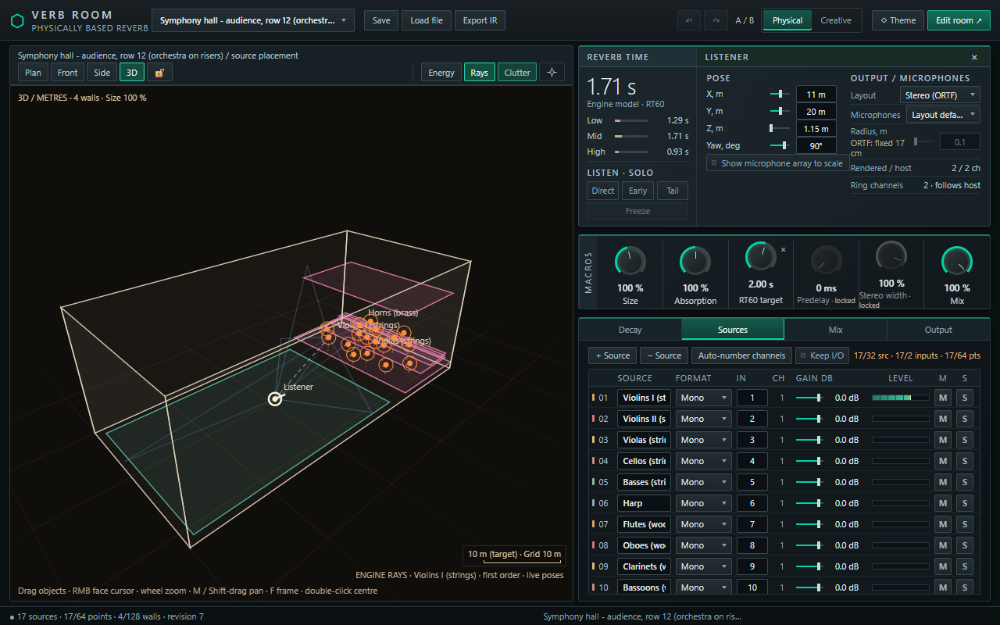

*Головна сторінка плагіна. Ліворуч вікно сцени, праворуч вибраний об’єкт і параметри звуку.*

- **Верхня панель.** У меню пресетів видно поточну кімнату. **Save** зберігає пресет, **Load file** завантажує файл, а **Export IR** експортує імпульсні відповіді. Кнопки зі стрілками скасовують і повторюють правки. **Physical** і **Creative** визначають, які налаштування діють. **Theme** містить налаштування оформлення, **About** (також є у верхній панелі **Edit room**) відкриває вікно з версією збірки, коротким описом змін, порадами, посиланнями на документацію та добровільною підтримкою проєкту, а **Edit room** відкриває редактор геометрії.
- **Вікно сцени.** Перемикай **Plan**, **Front**, **Side** і **3D** (план, фронт, бічний і тривимірний вигляди). На плані зручно розставляти об’єкти, а у Front чи Side — перевіряти висоти. Меню навігації містить **Frame all** (показати все), **Frame sel.** (показати вибране) і **Lock pan** (заблокувати панорамування). Головна сцена також має власну кнопку блокування. Перевір їх, якщо перетягування не діє.
- **Накладки.** **Energy** відкриває карту енергії. Вибери джерело, висоту зрізу, октавну смугу та компоненти Direct/Early/Tail, потім запусти аналіз. Карта показує модельоване покриття на зрізі й залишає звук без змін. **Rays** показує прямі й відбиті промені. **Clutter** показує розставлені перешкоди. **Paths** показує траєкторії руху та їхні точки. Див. [посібник аналізатора](Energy_analyzer_0.1.14_uk.md).
- **Інспектор і ряд макропараметрів.** Вибери джерело або слухача, щоб побачити параметри позиції, орієнтації й руху. Під інспектором розташовані **Size** (масштаб), **Absorption** (поглинання), **RT60 target** (цільовий час згасання), **Predelay** (попередня затримка), **Stereo width** (ширина) й **Output** (вихідний рівень).
- **Вкладки.** **Decay** показує сім кривих згасання та три творчі регулятори спаду. **Sources** містить канали, маршрутизацію та індикатори входів. У **Mix** розміщено рівні ранніх відбиттів і хвоста, дифузію, Доплер, сухий/оброблений баланс, компенсацію рівня та дакінг. **Modulation** налаштовує маршрути модуляції від руху та криві формування (у режимі Creative). **Settings** містить формат виходу, мікрофонні параметри, якість хвоста та параметри взаємодії з хостом.

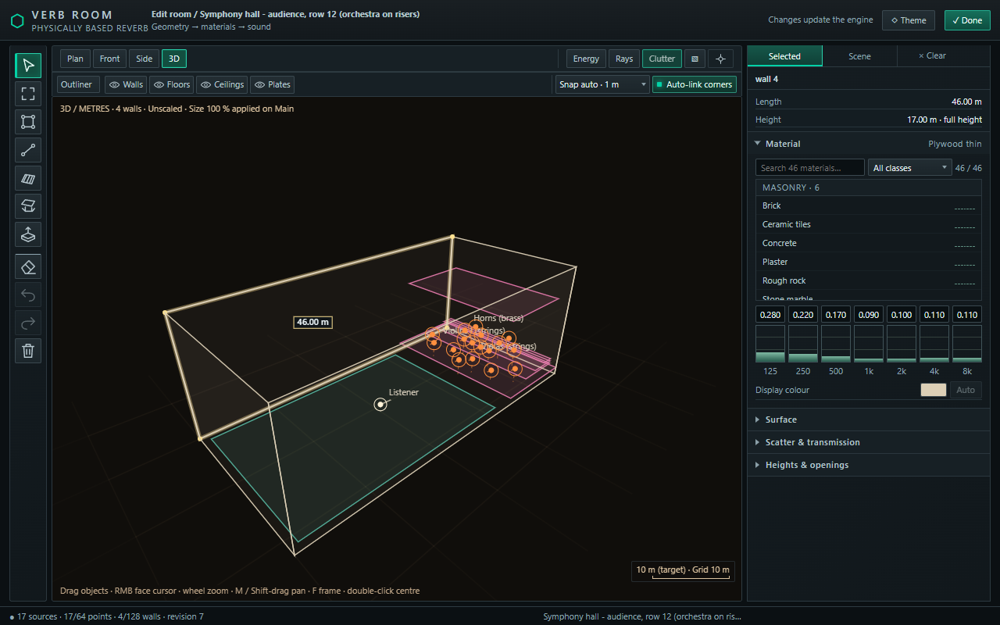

*Сторінка Edit room у плагіні. Малюй інструментами з панелі та задавай властивості поверхонь і матеріали в інспекторі.*

У **Edit room** є інструменти геометрії, кнопки шарів, **Outliner** (список поверхонь) та інспектор. Вибери поверхню для редагування або відкрий **Scene** для налаштувань усієї кімнати. **Done** повертає на головну сторінку. Рушій отримує зміни під час редагування. Outliner дає змогу вибирати, перейменовувати, приховувати, блокувати й зв’язувати поверхні. Приховані поверхні залишаються акустично активними. Зв’язки поверхонь пересувають геометрію разом. Групи руху **Group** синхронізують джерела й слухача.

<a name="rooms"></a>

## 4. Кімнати й матеріали

Для замкненої кімнати почни з **Plan**. Інструментом **Draw rectangular room** протягни від одного кута до протилежного, або вибери **Add wall** і задай дві кінцеві точки кожної стіни. З увімкненим **Auto-link corners** (автозв’язок кутів) наступний відрізок починається у попередньому куті. Подвійний клік замикає ланцюг, Escape або правий клік завершує його.

Щоб намалювати ділянку підлоги чи стелі, вибери **Add floor zone** або **Add ceiling zone**, клацни вершини й натисни Enter. Зони задають окремий матеріал на ділянках основних поверхонь. Для горизонтальної платформи чи навісу на власній висоті використовуй **Add raised plate**. Плити відбивають звук з обох боків. Перевір нижню й верхню межі стін і висоту плит в інспекторі та на вигляді **Front** або **Side**. У **Scene → Room** задай матеріали основної підлоги й стелі та висоту кімнати. **Open sky (no ceiling)** задає навмисно відкритий верх.

**Snap step** задає крок сітки для малювання й перетягування окремих кутів. **Auto · follows grid** використовує видимий крок сітки, фіксований крок дає змогу повторювати розміри, а **Off** вимикає прив’язку до сітки. Введені координати застосовуються точно. Кнопки **Walls**, **Floors**, **Ceilings** і **Plates** перемикають кожен шар між видимим, заблокованим і прихованим станами.

Вибери поверхню й у **Material** відкрий каталог матеріалів. Поглинання — частка енергії, яку поглинає матеріал у кожній із семи октавних смуг (125, 250, 500, 1000, 2000, 4000 і 8000 Гц). Втрати при проходженні (TL) показують, наскільки слабшає звук через матеріал. За меншого TL проходить більше звуку. Вибери матеріал за призначенням поверхні й перевір проходження перед тим, як застосувати його до масивної зовнішньої стіни. Зміна матеріалу впливає на звук і запікання.

У **Scene → Clutter** задай **Count** (кількість), **Min length** / **Max length** (довжину), **Min height** / **Max height** (висоту) та **Min TL** / **Max TL** (втрати) згенерованих перешкод. За тієї самої сцени й параметрів **Seed** відтворює їхнє розміщення, а **Randomize** змінює seed. **Source clearance** залишає вільний простір біля джерел і слухача. Накладка **Clutter** показує перешкоди. У **Scene → Air** налаштуй **Temperature** у °C та **Humidity** у відсотках відносної вологості. Рушій моделює поглинання повітрям у тих самих семи октавних смугах.

Для замкненої кімнати перевір стики всіх стін периметра, зокрема останньої з першою. Прибери дублікати, самоперетини та відрізки нульової довжини. Перевір стелю, ненавмисні отвори й зазори по висоті. Усі точки джерел і слухач мають бути вище платформ під ними й нижче стелі. Незшитий периметр може сповільнити запікання. Подай короткий імпульс, перевір згасання та різкі зміни й повторно завантаж збережений пресет, щоб підтвердити результат. Див. [інструкцію побудови сцен](Scene_authoring_agents_uk.md).

### З’єднання кутів

**Auto-link corners** рухає вже з’єднані кінці стін разом, коли перетягуєш стіну або кут. На вигляді **Plan** вибери стіну й підведи її кінець до іншого видимого кута, щоб прив’язати їх. Стіна або виділення прив’язуються, коли один із рухомих кінців наближається до нерухомого кута. Квадрат позначає ціль, а попередній перегляд показує нову геометрію. Магніт кутів працює і в режимі **Snap off**. Утримуй Alt, щоб вимкнути прив’язку, і натисни Undo один раз, щоб скасувати перетягування.

У **Scene → Room** лічильник **Open corners** показує кількість груп кінців стін із зазорами менше ніж 10 см. Вибери допуск 1, 5 або 10 см і натисни **Join corners**, щоб закрити зазори однією правкою. Крізь зазори може витікати звук, а **Bake path** може працювати повільніше. Заблокована стіна може бути опорною для стику. Команда пропускає групи з різними заблокованими кінцями, завеликим розкидом або стіною, що виродилася б у точку. Вона з’єднує кінці стін. Т-подібні стики посередині стіни та вершини зон виправляй вручну.

### Діапазон автоматизації

Типово параметри позиційної автоматизації хоста (`s1x..s32z` та `lx..lz`) охоплюють `−200…200 м` по X/Y і `0…30 м` по Z. Для невеликих або зміщених кімнат цей поекземплярний діапазон можна звузити в **Edit room → Scene → Automation range** без зміни ідентифікаторів параметрів і внутрішньої фізики в метрах:

- **Fit to scene:** Підбирає межі за всіма стінами, зонами, активними габаритами джерел і слухача та всіма точками траєкторій / точками огляду з автоматичним запасом, округленим до `0.5 м`. При переході від стандартного `±200 м` плагін спершу запитує підтвердження, адже зміна діапазону масштабує нормалізовані огинаючі автоматизації DAW у цьому екземплярі.
- **Ручні Min / Max і Reset:** Можна ввести власні межі (мінімальна ширина `1.0 м` по X/Y і `0.5 м` по Z) або повернути глобальні кнопкою **Reset (±200 m)**. Якщо звужений бокс не вміщує активні об’єкти, показується попередження з кількістю об’єктів, які буде обтиснуто (clamp); **Undo** одним кроком відновлює і попередній діапазон, і точні координати об’єктів.
- **Рамка на сцені та збереження:** Поки секція **Automation range** відкрита в Edit room, у видах **Plan**, **Front** і **Side** відображається пунктирна рамка меж. Зміна діапазону без обтискання об’єктів не змінює аудіо рушія та не інвалідує **Bake path**. Не-default межі зберігаються у станах проєкту DAW та пресетах `.verbroom`, розширюються (`union`) для локальних джерел/шляхів при **Keep I/O**, масштабуються разом із кімнатою при **Scale room** і скидаються на `±200 м` при завантаженні звичайних `.txt` або вбудованих кімнат.

<a name="sources"></a>

## 5. Джерела, слухач і виходи

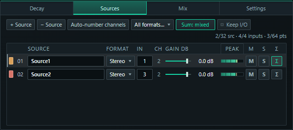

*Знімок браузерного стенда з тестовою маршрутизацією. Для першого стереоджерела Sum увімкнено, для другого — вимкнено.*

| Параметр джерела | Що робить |
| --- | --- |
| **Format** | Формат входу джерела. Доступні Mono, Stereo, LCR, Quad, 5.0, 5.1, 7.1 та Ring. |
| **In** / **Ch** | Перший вхід і число зайнятих каналів. Stereo з **In** 3 займає канали 3 і 4. |
| **Gain dB**, **M**, **S** | Підсилення, заглушення та соло джерела. Перевір Mute та Solo, якщо індикатор входу реагує, а джерела в міксі не чути. |
| **Σ** / **Sum** | Зводить багатоканальне джерело в одну точку рушія. Призначені канали входу лишаються зайнятими. Для моно перемикач недоступний. |
| **All formats…** | Змінює формат і перенумеровує входи джерел, що вкладаються в бюджет каналів і точок. Панель повідомляє, які джерела залишилися без змін. |
| **Sum for all sources** | Перемикає Sum для багатоканальних джерел. На кнопці видно **Sum: all on**, **Sum: all off** або **Sum: mixed**. Кожна масова дія скасовується одним Undo. |
| **Keep I/O** | Зберігає локальну конфігурацію джерел і виходу під час завантаження кімнати. Пози й параметри міксу можуть імпортуватися за індексом джерела. |

Панель показує використані джерела, канали й точки та попереджає про накладання маршрутів. Межі Verb Room — 32 джерела, 64 точки рушія, 64 входи й 16 рендерених виходів (на вихідних шинах хоста до 64 каналів). Після зміни формату, точок або send перевір використання бюджетів. Стереопара може бути одним джерелом із двома просторовими точками або однією точкою з увімкненим **Sum**.

### Спрямованість і наведення

В інспекторі джерела у **Instrument** вибери виміряний чи модельований профіль або вибери **None (analytic)** і задай **Directivity** (аналітичну спрямованість). Вбудовані виміряні профілі голосу й гучномовця мають атрибуцію CC BY 4.0. У списку також є модельовані інструментальні профілі. Щоб використати власні вимірювання, підготуй файл `.verbdir` через `verbdir_tool`, потім вибери **Load .verbdir file…** у списку профілів. Типовий каталог для пошуку — Profiles, останній використаний каталог запам’ятовується. Див. [інструкцію конвертера](../tools/VerbDirConverter.md) й [атрибуцію профілів](../THIRD_PARTY_DIRECTIVITY.md).

**Profile amount** змішує всеспрямовану діаграму (0%) з повним профілем (100%). Наведення профілю уточнює його орієнтацію відносно джерела через **Aim azimuth**, **Aim elevation** і **Aim roll** (азимут, кут підйому й крен). На полярній діаграмі видно напрям профілю. Виміряні профілі діють на прямий звук і ранні відбиття. Для пізнього трасування джерело з виміряним профілем всеспрямоване. Положення й орієнтація слухача та його приймачів далі впливають на модель.

### Слухач і маршрутизація виходів

Вибери слухача, щоб задати **X**, **Y**, **Z** і **Yaw** (азимут слухача). У **Settings → Output / microphones** задай **Layout** (формат виходу) та перевір **Rendered / host** (обчислені канали й канали хоста). Задай достатньо каналів доріжки в REAPER і спрямуй на них вихідні піни. Стереоформати включають ORTF та XY. Є також Mono, 5.1, 7.1 і 7.1.4. Доступність діаграми **Microphones** і радіуса **Radius** залежить від формату. **Human ears** моделює відстань між вухами й акустичну тінь голови.

| Вихід | Вихідні канали плагіна | Канали доріжки REAPER для цього виходу |
| --- | ---: | ---: |
| Mono / стерео | 1 / 2 | 2 |
| 5.1 / 7.1 / 7.1.4 | 6 / 8 / 12 | 6 / 8 / 12 |
| AmbiX (1st order) | 4 | 4 |
| AmbiX (2nd order) | 9 | 10 |
| AmbiX (3rd order) | 16 | 16 |

Якщо входам потрібно більше каналів, збільш їх кількість на доріжці. Амбісонічна розкладка фіксує масив мікрофонів. Узгодь декодер із **Ambisonics normalization** і виділи на доріжці достатньо каналів для вибраного порядку.

| Ambisonics normalization | Порядок каналів і підсилення |
|---|---|
| **SN3D** (типово) | AmbiX, порядок ACN і канал W без ослаблення. |
| **N3D** | Порядок ACN із множником √(2n + 1) для кожного порядку n. |
| **FuMa** | Історичний порядок Furse–Malham WXYZ RSTUV KLMNOPQ із вагами MaxN і W на рівні 1/√2. Відсутні компоненти на вузькій шині дають тишу. |

**Ambisonics level** однаково ослаблює всі амбісонічні канали після нормалізації. Доступні **0 дБ** (типово), **−3 дБ** і **−6 дБ**. Для порівняння зі стерео вимірюй декодований сигнал. Стан проєкту та пресет кімнати зберігають обидва параметри, **Keep I/O** залишає локальні значення, а експорт імпульсів використовує вибрані порядок каналів і рівень.

<a name="controls"></a>

## 6. Параметри й режими

**Physical** використовує згасання й рівні акустичної моделі. **Creative** застосовує збережені поправки, зокрема **Early level** (рівень ранніх відбиттів), **Tail level** (рівень хвоста), **Doppler** і три регулятори **Decay by band** (згасання за смугами). **Low 125–250 Hz**, **Mid 500–2k Hz** і **High 4k–8k Hz** змінюють групи смуг. На графіку **Decay** видно сім модельованих кривих і оцінки RT60. Частини з екстраполяцією є прогнозом.

**Absorption** масштабує поглинання в обох режимах (0,3–3,0). Задай потрібний час у секундах і натисни **RT60 target**. Помічник змінює поглинання, наближаючи час згасання в середніх смугах (500 Гц–2 кГц) до цілі. Перевір результат на графіку, особливо якщо цільовий час виходить за межі моделі.

**Size** масштабує кімнату й пози під час роботи в обох режимах цієї збірки. Команда **Scale room** у редакторі геометрії застосовує масштаб один раз. **Predelay**, **Stereo width**, **Duck** (**Amount** і **Release**) та **Freeze** — параметри Creative. Predelay затримує оброблений звук, Stereo width змінює ширину там, де вона доступна, Duck послаблює відбитий звук за наявності вхідного сигналу, а Freeze утримує хвіст. Після переходу на Physical збережені параметри знову діють, коли повернешся до Creative.

У **Mix** перемикач **Positioned dry** підпорядковує прямий звук положенню джерел і слухача. З увімкненим Positioned dry регулятор **Mix** змінює кількість відбитого звуку, зберігаючи модельований прямий сигнал. З вимкненим перемикачем Mix плавно змішує необроблений вхід і модельований звук кімнати. У **Listen · solo** перемикай **Direct**, **Early** та **Tail**, щоб прослухати окремі компоненти чи їхні комбінації. **Output** задає загальний рівень, а **Makeup** додає підсилення. **Auto** розраховує Makeup за останньою готовою моделлю, тож перед натисканням зупини рух. Індикатори показують кінцевий вихідний рівень.

**Сухий сигнал і вхідні канали 1/2.** Виходом Verb Room є перші вихідні канали (1/2 для стерео або канали розкладки для surround/Ambisonics). З увімкненим **Positioned dry** (за замовчуванням) сирий вхід на вихід не надходить: прямий звук кожного джерела з будь-якого вхідного каналу відтворюється моделлю кімнати, а **Mix** лише змінює кількість відбитого звуку (окрім активного **Listen** solo, що тримає вихід на 100 % «мокрому» сигналі). З вимкненим **Positioned dry** **Mix** рівнопотужно змішує кімнату із сирими вхідними каналами, які проходять напряму як канал *k* → вихід *k* для кожного каналу в межах ширини вихідної шини хоста (з урахуванням **Mute** / **Solo** для призначених джерел і примусово на 100 % «мокрим» виходом при активному **Listen** solo). На стереовиході таким шляхом можуть пройти лише входи 1 і 2, тому в цьому режимі тримай джерела на вхідних каналах 3 і далі, якщо вихід 1/2 має лишатися чисто «мокрим», або лиши **Mix** на 100 %. На 2-канальній шині хоста вхідні канали 3 і далі плагін не змінює: хост передає їх далі без змін на тих самих каналах треку, а стереомайстер їх просто не відтворює (про ширші вихідні шини хоста до 64 каналів див. нижче). Якщо зробити мікс усіх каналів шини (плагін-міксдаун для моніторингу після Verb Room або send, що несе більше за канали 1/2), ці незмінені сухі канали стануть чутними, хоча індикатори Verb Room показують тишу. Слухай лише канали 1/2, наприклад через типовий parent/master send, який несе канали 1/2. Якщо ти все одно чуєш сухе джерело при заглушеному треку Verb Room, вимкни власний master/parent send треку джерела в REAPER. Змодельований прямий звук джерела є частиною моделі кімнати, тому на нього діють **Gain**, **Mute** і **Solo** джерела. Сирий сухий шлях вимкненого **Positioned dry** не залежить від **Gain** джерела, тож із вимкненим **Positioned dry** і **Mix** 0 % входи 1/2 просто проходять наскрізь, як байпас, незалежно від **Gain**. Щоб почути **Direct**, **Early** і **Tail** окремо, використовуй **Listen · solo**.

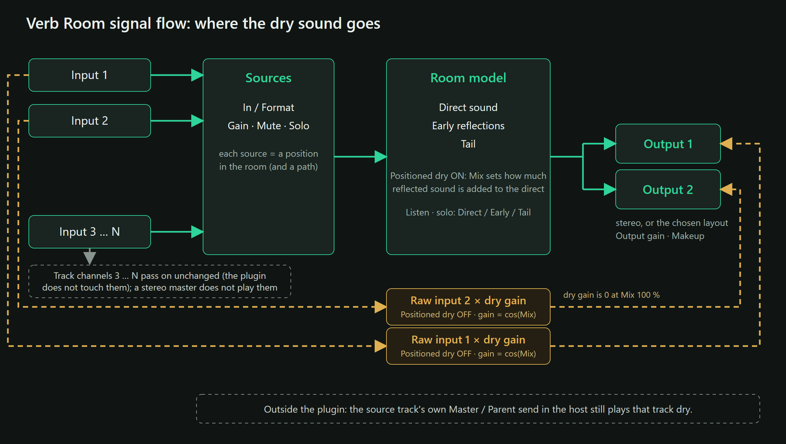

**Багатоканальні та амбісонічні виходи.** Verb Room виводить перші `nOut` каналів, узгоджені з хостом, і рендерить у них до 16 каналів розкладки `R` (4 для Quad чи AmbiX 1-го порядку, 6 для 5.1, 12 для 7.1.4 або 16 для AmbiX 3-го порядку чи Ring); канали доріжки за межами `nOut` хост передає далі без змін. На ширшій вихідній шині хоста до 64 каналів (наприклад, на 64-канальній доріжці REAPER із 32-джерельним шаблоном VSL) Verb Room керує всіма `nOut` вихідними каналами (**Rendered / host** показує, наприклад, `2 / 64 ch` або `16 / 64 ch`) і з увімкненим **Positioned dry** глушить канали `R+1..nOut` замість наскрізного пропуску необроблених входів. Для роботи в REAPER задай на доріжці щонайменше `R` каналів (4, 6, 12, 16 або 64; на 10-канальній доріжці з 9-канальним AmbiX 2-го порядку 10-й канал заглушується). З амбісонікою та surround тримай **Positioned dry** **увімкненим** (з вимкненим перемикачем за **Mix** < 100 % сирі входи підмішуються *k* → *k*, що не має сенсу для амбісонічних компонент і багатоканальних розкладок), а моніторинг налаштовуй лише на рендерені вихідні канали 1–`R`.

### Автоматизація в REAPER

Список параметрів FX містить **Mode**, **Size**, `absorption`, `decayLow`, `decayMid`, `decayHigh`, **Early Reflections**, **Tail Level**, **Early Diffusion**, **Doppler Strength**, **Predelay**, **Stereo width**, **Freeze**, **Duck amount**, **Duck release**, **Dry/Wet Mix**, **Positioned Dry**, **Solo Direct**, **Solo Early**, **Solo Tail**, **Output Gain** і **Makeup**. Там також є **Gain**, **Mute** і **Solo** кожного нумерованого джерела та параметри пози й траєкторії, описані далі. Дія параметра залежить від вибраного режиму.

Малювання кімнати, матеріали, маршрутизація та профілі джерел, формат виходу, якість хвоста, **RT60 target**, **Auto** для Makeup і кнопки запікання — команди редактора. Для огинаючої рівня чи поглинання використовуй параметр **Makeup** або `absorption`. Щоб підвищити точність малювання огинаючих X/Y/Z у DAW для конкретної кімнати, налаштуй **Edit room → Scene → Automation range**.

<a name="movement"></a>

## 7. Рух і траєкторії

1. Вибери джерело або слухача. У розділі **Path** натисни **Draw path** (намалювати траєкторію). Клацни щонайменше дві точки в сцені й заверши Enter, подвійним кліком або кнопкою **Drawing… (Finish)**. Escape скасовує малювання. У режимі **Edit** перетягуй, вставляй, додавай чи прибирай точки. **Clear** видаляє траєкторію й повертає статичні XYZ.
2. Увімкни **Enabled**, щоб об’єкт рухався траєкторією. **Closed** з’єднує кінець із початком. **Smooth** згладжує криву між точками. Для замкненої траєкторії **Laps** задає кількість кіл у вікні руху.
3. Потягни **Position**, щоб перевірити рух. **Start %** і **End %** задають вікно в діапазоні керування 0–100%. Поза ним об’єкт утримує початкову або кінцеву позицію. Ключі **Time %** задають, коли об’єкт досягає певної точки всередині вікна. Easing визначає профіль руху між точками. Кнопка **Path timeline** відкриває панель зі спільним оглядом вікон, ключів та індикаторів позиції. Її горизонтальна вісь — Position у відсотках. Секунди чи долі задаються на огинаючій REAPER.
4. Для зв’язаного руху вибери однакову **Group** у **Coupling** для кожної ввімкненої траєкторії. Учасники зберігають свої траєкторії, вікна й easing, але отримують спільний параметр **Position**. Шукай **Drives Group …** (керує групою) або **Driven by …** (хто керує) в інспекторі. Власна огинаюча Path position веденого об’єкта не керує групою.
5. Вибери **Orientation** (орієнтацію). **Manual** використовує керований вручну або автоматизований **Azimuth** джерела чи **Yaw** слухача. **Along path** спрямовує об’єкт уздовж траєкторії, а **Look at** повертає до джерела, слухача чи фіксованої точки **Point…**. В останніх двох режимах кутовий параметр додає зміщення. **Profile aim** окремо коригує напрям профілю джерела.

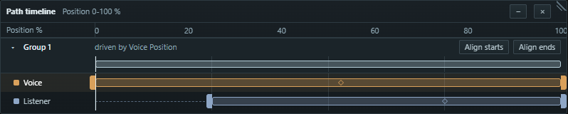

*Знімок браузерного стенда з тестовими траєкторіями. Voice (Source 1) керує Group 1, слухач починає рух на 25% тієї самої осі Position.*

### Ключі азимуту

Кожне рухоме джерело або слухач (`points >= 2`) має у **Path timeline** підрядок **Azimuth** із графіком кута −180…180° (із безшовним переходом через межу ±180°). Ключі азимуту діють лише в режимі **Orientation = Manual** і мають пріоритет над прямим керуванням повзунком **Azimuth**:

- **Додавання та редагування ключів:** Натисніть **+ Key**, щоб зафіксувати поточний кут на позиції плейхеда, або двічі клацніть порожню доріжку Azimuth. Клацніть маркер ключа, щоб відкрити нижній редактор **Angle** (повзунок або подвійний клік на числовому полі; **Shift** дає точність 0.1°).
- **Час, криві та видалення:** Перетягуйте ключ уздовж осі між сусідами (**Shift** = крок 0.05 %) або зсувайте сфокусований маркер стрілками **Ліворуч/Праворуч**. Правий клік по ключу відкриває меню **Linear**, **Ease in**, **Ease out**, **Ease in-out**, **Hold** (ступінчаста зміна) і **Delete key** (**Del** / **Backspace** теж видаляють ключ). Кожен жест тягання записується як один крок Undo.
- **Поворот у в'юпорті:** Праве перетягування в **Plan** або **3D** обертає лише вибраний ключ або ключ у межах ±0.5 % від плейхеда; спроба обертати поза ключами без вибору залишає ключі й хост-параметр без змін і показує підказку. Для рухомих об'єктів із 0 ключами повзунок і ПКМ-поворот працюють напряму, як і раніше.
- **Блокування повзунка та інші режими орієнтації:** За активних ключів у **Manual** повзунок **Azimuth** в інспекторі заблокований (з пояснювальною підказкою) і відображає інтерпольований кут, а рядок `Azimuth keys: N` містить кнопку фокусу **Timeline**. Перемикання на **Along path** або **Look at** приглушує смужку з підказкою та зберігає всі ключі.

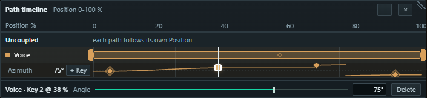

*Знімок браузерного стенда: рухома траєкторія Voice із чотирма ключами азимуту (Ease in-out, Hold і перехід через ±180°) та вибраним ключем 2 у редакторі Angle.*

### Як намалювати огинаючу в REAPER

У списку параметрів FX відкрий огинаючу **Source 1 Path position** (або параметр потрібного номера джерела), чи **Listener Path position** для незалежного слухача. Для Group відкрий лише огинаючу того, хто керує. Постав дві точки у вибраний час початку й кінця, на мінімумі та максимумі параметра (0 і 1, або 0% і 100% на індикаторі Position у плагіні). Почни з лінійної ділянки. Додай горизонтальні ділянки до і після, якщо хочеш утримати кінцеві пози.

Статичні **X**, **Y** і **Z** джерела й слухача, **Azimuth** джерела та **Yaw** слухача також доступні хосту. Увімкнена траєкторія визначає XYZ за Position. Для руху без намальованого шляху автоматизуй статичні XYZ. Точки, вікна руху, easing, кола, групи та режим і ціль орієнтації редагуються в плагіні. Увімкни **Keep processing during silence** у **Settings**, якщо автоматизація Position має діяти ще до першого звуку. Це збільшує навантаження на CPU.

<a name="motion-modulation"></a>

### Модуляція руху

У режимі **Creative** (`Mode = Creative`) доступні два інструменти динамічного керування звуком від руху: **Маршрути модуляції** та **Path LFO**. Обидва діють **лише в режимі Creative**: після перемикання у **Physical** модуляція чисто вимикається, але всі налаштовані маршрути, криві й LFO зберігаються та знову активуються при поверненні в **Creative**. Про це чітко нагадують підказки на вкладці **Modulation** і в секції **Path LFO**.

#### Маршрути модуляції (вкладка `Modulation` і плаваючий редактор)

Кожен маршрут зв’язує об’єкт-драйвер (**Source 1..32** або **Listener**) і один з 11 просторових/кінематичних **драйверів** із по-джерельною або глобальною **ціллю** через криву перетворення й згладжування атаки/спаду (до 64 маршрутів у проєкті):

- **Вбудований редактор у вкладці й опційний Detach:** Повний редактор **Modulation** (панель кнопок з **+ Add route**, **Add from preset…**, список маршрутів ліворуч, інтерактивна крива, панель вузлів, діапазони та жива телеметрія праворуч) працює безпосередньо всередині нижньої вкладки **Modulation**; потягни роздільник угору, щоб зробити його ще вищим. Натисни **Detach ↗** або кнопку **Mod** у верхньому тулбарі сцени (доступна і на **Main**, і в **Edit room**), щоб відкріпити плаваюче вікно поверх сцени. Коли вікно відкріплено, нижня вкладка показує компактний список і кнопку **Dock ↙**; плаваюче вікно можна перетягувати за заголовок (подвійний клік скидає), масштабувати за правий верхній кут, згортати (`−`) або повернути назад (`Dock ↙` / `Mod` / `×` / `Esc`). Вибір зі списку **Add from preset…** завжди додає **новий** маршрут (виділяє його, коротко підсвічує рядок і показує в рядку стану `Added route: <Driver → Target>`, не змінюючи вже обраного маршруту), а подвійний клік по рядку лише обирає маршрут без авто-відкриття вікна. Кожен рядок списку однозначно показує повне **Driver → Target**, об’єкт, явний індикатор **Active / Off / Bypassed** і живе значення цілі з одиницями.

  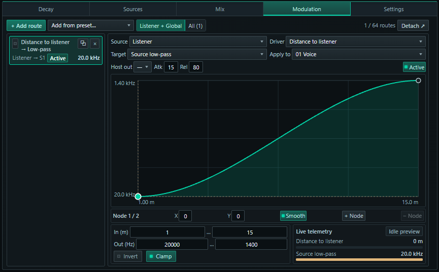

  *Докована вкладка **Modulation** із маршрутом «**Distance to listener → Low-pass**» (`In 1–15 м`, `Out 20000–1400 Гц`), кривою перетворення та живою телеметрією.*

- **11 драйверів:** **Distance to listener** (відстань до слухача), **Distance to point** (відстань до довільної точки з полями **X / Y / Z**), **Azimuth to listener** (кут відносно напряму слухача, ±180°), **Elevation angle** (вертикальний кут), координати **X**, **Y**, **Z**, згладжена 3D-швидкість **Speed**, знакова радіальна швидкість **Radial speed** (віддалення зі знаком `+`, наближення `−`), **Path position** (підписаний у діапазоні як **In (path 0–1)** — ефективна позиція `0..1` вздовж траєкторії разом із Path LFO) та **Distance to nearest wall** (відстань до найближчої стіни).
- **8 цілей і безпечна зміна Target / Driver:** По-джерельні **Source gain Δ** (`-60..+12 dB`), **Source low-pass** (`20..20000 Hz`), **Source high-pass** (`20..20000 Hz`), **Source low shelf** (`-12..+12 dB`) та **Source high shelf** (`-12..+12 dB`, діють на те саме або інше джерело через **Apply to**); глобальні **Early level Δ** (`-60..+6 dB`), **Tail level Δ** (`-48..+12 dB`) і **Wet / dry mix Δ** (`-100..+100 %`). Кілька маршрутів на одну ціль додаються в дБ / % (або у log₂-октавах для LPF/HPF). Вихідні діапазони затискаються до допустимих меж цілі; зміна **Target** атомарно (за 1 крок Undo) скидає `Output range` до безпечних значень і повертає лінійну криву, а зміна **Driver** скидає `Input range` до типового для нового драйвера.
- **Крива перетворення, згладжування та жива телеметрія:** Перетягуй 2–8 вузлів на інтерактивному графіку (подвійний клік на порожньому місці чи кнопка **+ Node** додає вузол; **Del** або **− Node** видаляє; один жест перетягування записується як один крок Undo). Вмикай згладжування сегмента **Smooth**, задавай числові **Node X / Y**, діапазони **In / Out**, **Invert**, **Clamp**, час **Atk ms** (0–2000 мс) і **Rel ms** (0–5000 мс). Блок **Live telemetry** та рухоме перехрестя на кривій у реальному часі показують поточне значення драйвера й результуючий вихід.

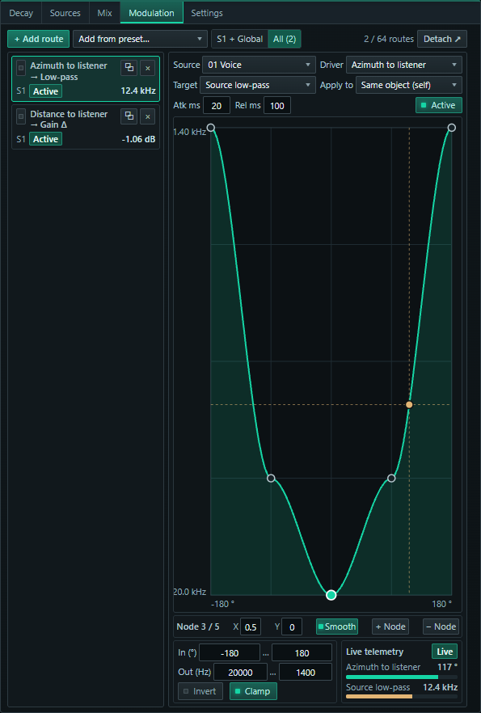

*Відчеплена (плаваюча) панель Modulation із двома активними маршрутами, 5-точковою кривою та живою телеметрією драйвера й цілі.*

#### Path LFO

Траєкторії з принаймні двома точками (`points >= 2`) мають секцію **Path LFO** в інспекторі шляху поруч із **Position** та **Coupling**:

- Керуй перемикачем **Path LFO**, формою хвилі **Shape** (`Sine`, `Triangle`, `Saw`, `Square`, `Smooth random`), частотою **Rate** (`0.05–8 Hz`), глибиною **Depth** (`0–100 %` ходу траєкторією) та початковою фазою **Phase** (`0–360°`).
- **Індикатор розмаху й захист країв:** **Path LFO** коливає рух навколо повзунка **Position** (живий рядок **Swing a–b %**). Якщо розмах виходить за `0 %` або `100 %`, з’являється попередження про край траєкторії (**Closed** циклічно загортається на `[0, 100%)`, а відкрита траєкторія затискається на краях) і кнопка **Keep inside path**, яка обмежує **Depth** до найбільшого безпечного цілого відсотка. Path LFO синхронізується з транспортом DAW (коли транспорт зупинено, осцилятор стоїть у фазі `0°`).
- **Базова траєкторія і сумісність із Bake:** Вікно сцени завжди відображає **базову геометрію траєкторії** (на **Path timeline** навколо плейхеда позначається розмах коливання). Увімкнення чи зміна Path LFO не змінює геометрії траєкторії й **не робить запечену таблицю Bake застарілою**.

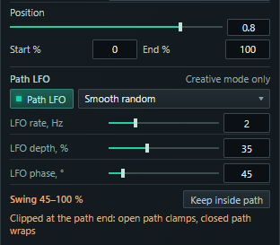

*Знімок браузерного стенда в Edit room: елементи Path LFO (Smooth random, частота, глибина й фаза), індикатор Swing, попередження краю траєкторії та кнопка Keep inside path.*

#### Використання модуляції в інших плагінах

Кожен маршрут модуляції в режимі **Creative** має опційний слот **Host out** (`—` або `1`–`16`), що відповідає шістнадцятьом параметрам хоста **`Mod Out 1`** … **`Mod Out 16`** наприкінці списку параметрів Verb Room (вони відображаються у списках як звичайні автоматизовані параметри, щоб DAW, зокрема REAPER, дозволяли прив’язку до них):

- **Вибір цілі:** Обери будь-яку внутрішню ціль Verb Room, щоб керувати звуком плагіна та слотом хоста одночасно, або вибери **Host output only** (`none`), якщо потрібна чиста зовнішня крива модуляції без впливу на звук самої реверберації.
- **Формат сигналу та режими:** Активний слот передає **згладжений вихід кривої маршруту в нормалізованому діапазоні `0–1`** (до масштабування у фізичні одиниці цілі), обмежений до `[0, 1]` із оновленням раз на аудіоблок при зміні понад `1e-4` (із допустимою затримкою до 1 блока відносно ефектів до або після Verb Room на треку). Якщо кілька увімкнених маршрутів скеровані на один слот, перемагає останній увімкнений у списку. У режимі **Physical** усі `Mod Out 1–16` плавно повертаються до нейтрального значення **`0.5`**.
- **Не малюй автоматизацію на `Mod Out 1–16`:** Хоча `Mod Out 1–16` видимі у списках параметрів і огинаючих для прив’язки в хості, це **вихідні канали модуляції Verb Room**. Запис огинаючих автоматизації чи ручне переміщення ручок `Mod Out` **ігноруються** і нічого не змінюють.
- **Підключення у REAPER (`Link from FX parameter`):**
  1. Увімкни в Verb Room режим **Creative** та створи маршрут (наприклад, **Distance to listener → Host output only**, **Host out** = `1`).
  2. На потрібному плагіні до або після Verb Room натисни **Param** → **Parameter modulation / MIDI link**.
  3. Увімкни **Link from FX parameter**, вибери **Verb Room** → **`Mod Out 1`** та налаштуй масштаб і зміщення.

#### Відомі обмеження

- Швидкість LFO задається виключно в герцах (**Hz**); **синхронізація з темпом хоста** (нотними частками) не підтримується.
- **Класичний редактор (Classic UI)** не містить матриці модуляції та Path LFO; налаштовуй їх у вебредакторі.

<a name="baking"></a>

## 8. Запікання хвоста

**Bake path** у рядку **Bake late tail** заздалегідь обчислює таблицю пізнього хвоста, щоб реверберація змінювалася під час руху. Для придатних намальованих траєкторій одразу натисни **Bake path**. Для руху, який задає REAPER, натисни **Record automation** у рядку **Host automation**, програй рух один раз, натисни **Stop**, а потім **Bake path**.

### Що буде чути

Прямий звук і ранні відбиття вже слідують за поточними позами. Трасування пізнього хвоста потребує більше ресурсів, тому під час руху плагін оцінює його за наявним хвостом. Коли пози залишаються сталими приблизно **0,4 секунди**, рушій планує одне точне оновлення для усталеної пози. Сам розрахунок і перехід потребують додаткового часу. Без запікання хвіст під час руху може помітно відрізнятися від кінцевого.

Із запіканням плагін заздалегідь трасує пози вздовж руху й використовує таблицю для оцінки хвоста, коли відтворення відповідає цьому руху. Зміни хвоста чути ще до того, як об’єкти зупиняться. В усталеній позі рушій усе одно переходить до точного хвоста.

<a name="bake-decision"></a>

### Чи потрібне запікання і як його зробити?

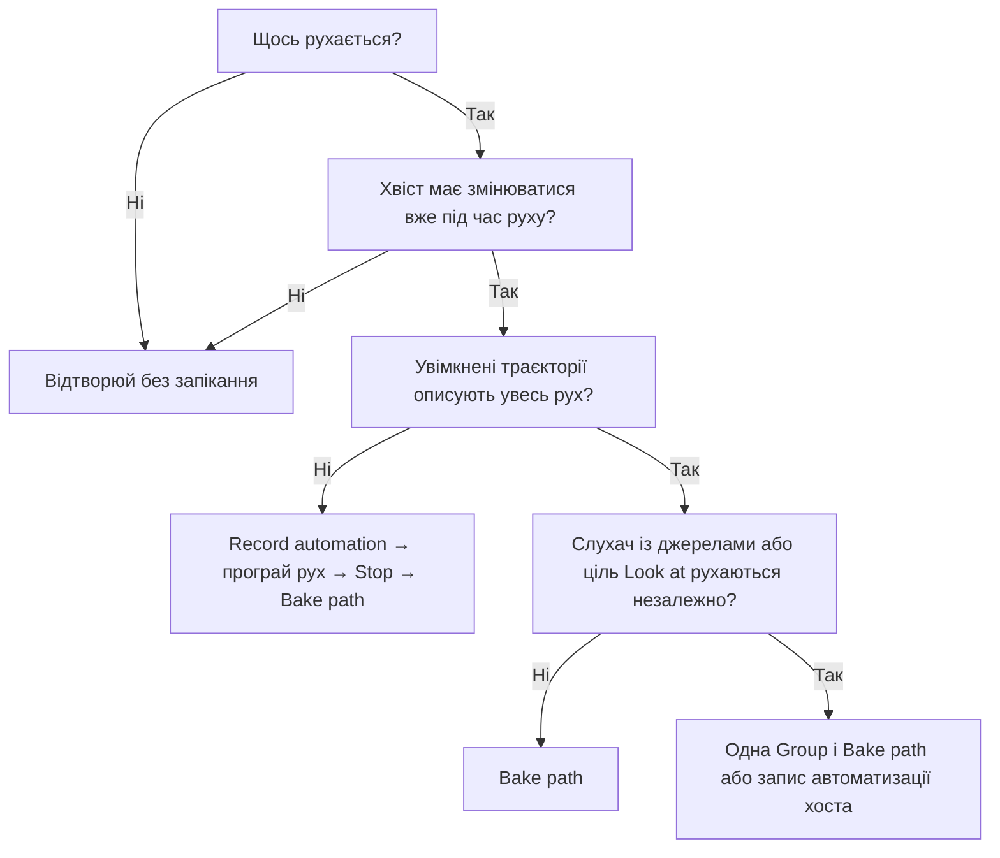

| Моя ситуація | Що робити |
| --- | --- |
| Руху немає або поточне наближення влаштовує | Відтворюй без запікання. Дай позі усталитися. |
| Одне джерело рухається намальованою траєкторією | Увімкни її та натисни **Bake path**. |
| Кілька джерел рухаються незалежними траєкторіями, слухач нерухомий | Увімкни траєкторії й натисни **Bake path**. Плагін може обчислити таблиці для незалежних джерел. |
| Лише слухач рухається намальованою траєкторією | Увімкни її та натисни **Bake path**. |
| Слухач і джерела рухаються разом | Додай усі рухомі траєкторії в одну **Group**, автоматизуй її параметр Position і натисни **Bake path**. |
| Слухач рухається, джерела йдуть незалежними траєкторіями | Зведи всі рухомі траєкторії в одну **Group** і запечи або скористайся записом автоматизації хоста за кроками нижче. |
| Рух задають лише огинаючі XYZ або кута в REAPER | Натисни **Record automation**, програй рух один раз, натисни **Stop** і **Bake path**. Повтори той самий рух. |
| Ціль **Look at** рухається незалежно від рухомого об’єкта | Додай обидві траєкторії до однієї **Group** і запечи або скористайся записом автоматизації хоста за кроками нижче. |
| У рухомого об’єкта в **Manual** є автоматизація кута | Запечи траєкторію чи групу. Для незалежно керованого руху запечи запис. Без ключів азимуту зміна ручного кута не відкидає таблицю (прямий звук і ранні відбиття слідують наживо); за активних ключів азимуту їхня крива запікається в таблицю. |
| AmbiX або велика сцена | Вибери спосіб за типом руху. Заклади більше часу на трасування, особливо за великої кількості джерел, виходів або променів. |

<a name="bake-workflows"></a>

### Запікання намальованих траєкторій

1. Намалюй і ввімкни кожну траєкторію. Якщо рухаються слухач і одне чи кілька джерел, признач усім рухомим траєкторіям однакову **Group**. Налаштуй вікна руху, easing і орієнтацію. Налаштуй огинаючу REAPER для незалежної траєкторії або керівного об’єкта групи, потім перевір рух через **Position**.
2. Зупини відтворення й заверши правки. Задай формат виходу та якість хвоста, з якими працюватимеш. Натисни **Bake path** у розділі **Path** рухомого об’єкта.
3. Дочекайся завершення. **Baked** означає, що таблиця готова. **Baked (approx.)** теж дає придатну таблицю, але похибка на окремих ділянках вища за допуск.
4. Програй уривок і перевір **Tail** у **Listen · solo**, поки об’єкти рухаються. Потім поверни повний мікс.

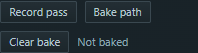

*Знімок браузерного стенда до запікання незалежної намальованої траєкторії. Натисни Bake path у рядку Bake late tail.*

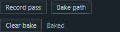

*Знімок браузерного стенда після імітованого запікання намальованої траєкторії.*

### Як записати прохід REAPER і запекти його

Застосовуй цей спосіб, якщо рух задає автоматизація хоста або рухомий слухач чи ціль Look at не можуть використовувати спільну Group. **Bake source** показує, що візьме **Bake path**. Придатні намальовані траєкторії мають пріоритет. Запис використовується, коли намальованих траєкторій немає або їх запікання заблоковане. Якщо рух задано лише через XYZ або кут, вимкни траєкторії, що можуть перебрати керування. Рекордер захоплює також зміни самого кута. Після запікання послухай **Tail**, щоб оцінити, як хвіст слідує за поворотом у Manual. Якщо REAPER керує незалежними траєкторіями під час запису, залиш їх увімкненими.

1. Постав курсор REAPER перед початком руху. У розділі **Path** джерела чи слухача натисни **Record automation** у рядку **Host automation**. На кнопці з’явиться **Armed - Stop**.
2. Натисни Play у REAPER. Один раз програй рух так, щоб хост передавав плагіну блоки для обробки. Кнопка показує **Recording N - Stop** і кількість зібраних відліків пози.
3. Наприкінці натисни **Stop** на тій самій кнопці запису в плагіні. Зупини REAPER і перевір напис **Recorded N - Record again**.
4. Перевір, чи **Bake source** показує `recorded automation (N samples)`. Виділене повідомлення `Recorded - now press Bake path to compute the tail` означає, що запис готовий. У рядку **Bake late tail** натисни **Bake path** або **Bake again**, якщо на кнопці такий напис. Дочекайся **Baked** або **Baked (approx.)**.
5. Повернися на початок і програй ті самі огинаючі та рух. Якщо змінився маршрут чи взаємний час руху, натисни **Record again**, програй новий рух і запечи новий запис.

### Після правок, під час збереження та зупинки

| Що змінилося | Що робити |
| --- | --- |
| Геометрія, матеріали, поглинання чи розмір кімнати, формат виходу або якість хвоста | Залежна таблиця може стати **Outdated** (застаріла). Заверши правки й натисни **Bake again**. Якщо змінилися самі записані пози чи рух, запиши прохід заново. |
| Намальований шлях, вікно руху, ключ, кола, Group або налаштування орієнтації | Перевір новий рух і натисни **Bake again**, якщо таблиця застаріла. |
| Набір джерел, розташування їхніх точок або нерухомі учасники сцени для запікання | Перевір маршрутизацію й пози. Повтори запікання залежних траєкторій. Запиши прохід знову, якщо змінився набір джерел або рух. |
| Лише огинаюча Position у REAPER | Якщо та сама намальована траєкторія тепер програється в інший час, таблиця лишається придатною. Якщо використовуєш запис і послідовність поз більше не збігається, запиши прохід знову. |
| Поточний кут **Manual** на рухомій траєкторії | Відтворення може далі використовувати таблицю. Для намальованої траєкторії враховано кут на час запиту Bake. Для запису враховано захоплені кути. Запечи ще раз або запиши новий прохід, якщо таблиця має враховувати інші кути. |
| Undo або повернення до попередньої кімнати й траєкторії | Сумісна таблиця може відновитися з кешу. Перед повторним запіканням перевір статус. |

**Cancel** зупиняє запікання. **Clear bake** видаляє всі запечені таблиці й зберігає траєкторії та запис. **Discard** (у ряду Host automation) зупиняє підготовлений або активний запис, видаляє його й прибирає запікання, зроблене з нього. Таблиці намальованих шляхів зберігаються. **Bake again** розраховує таблицю для поточної сцени й руху. **Clear** у засобах малювання видаляє вибрану траєкторію.

Проєкт може відновити сумісну таблицю та запис її проходу. `.verbroom` може відновити сумісні таблиці намальованих траєкторій. Якщо рух залежить від записаного проходу, передавай проєкт, оскільки `.verbroom` пропускає захоплені пози. Завелика для збереження таблиця, таблиця для іншої сцени, або старіша таблиця рухомого учасника в Manual можуть потребувати нового запікання. Таблиці з 0.2.0 завжди потребують одного нового запікання. Після повторного відкриття перевір статус.

<a name="bake-status"></a>

### Статуси запікання й запису

Інспектор показує стан траєкторії. Нижній рядок показує перебіг усього запікання та причини очікування. Назви, відсотки й лічильники залежать від сцени.

| Напис в інспекторі або нижньому рядку | Що означає і що робити |
| --- | --- |
| `Not baked` | Для цієї траєкторії немає придатної таблиці. Відтворюй як є або натисни **Bake path**. |
| `Baking N %` / `Baking path · NAME · N %` | Запікання триває. Дочекайся зміни причини чи прогресу або натисни **Cancel**. |
| `Tracing stations - D/T stations` / `Refining path - D/T stations` | Рушій трасує контрольні пози або уточнює ділянки. Лічильник може певний час стояти. |
| `Baked` / `Path baked` / `NAME baked` | Таблиця актуальна. Програй рух. |
| `Baked (approx.)` / `Path baked (approx.)` / `N intervals above tolerance` / `Some intervals exceed tolerance` | Є придатна таблиця, але на окремих ділянках похибка вища за допуск. Прослухай переходи. |
| `Look at path sampling relaxed xN (station cap)` | Під час розрахунку Look at досягнуто ліміту контрольних поз. Прослухай місця зі швидким поворотом. |
| `restored from the saved project` / `restored after undo` | Відновлено сумісну таблицю зі збереженого стану чи кешу. Перевір статус і програй. |
| `bake not stored: too large` | Поточна таблиця придатна для цієї сесії. Якщо проєкт чи пресет не може її зберегти, після відкриття запечи знову. |
| `Outdated` / `Room, quality or path changed - bake again` / `Room, quality or recorded pass changed - bake again` / `Path needs a new bake` | Таблиця більше не відповідає налаштуванням. Заверши правки й запечи знову. |
| `Not baked · Cancelled` / `Not baked · Cancelled · Cancelled` / `Path bake cancelled` | Запікання скасовано. Запусти його знову після підготовки. |
| `A room is loading` | Кімната ще завантажується, тому команда недоступна. Дочекайся завершення завантаження та повтори. |
| `Cannot bake` | Для цього руху потрібні придатні траєкторії або запис. Перевір уточнення. |
| `Enable a path or record a pass before baking` | Увімкни траєкторію з двома або більше точками чи запиши придатний прохід. |
| `Cannot bake uncoupled moving listener with sources - assign them to one Group or record a pass` | Слухач рухається незалежно, і є інші рухомі траєкторії. Згрупуй усі рухомі траєкторії або запиши прохід. |
| `Cannot bake uncoupled paths alongside a moving listener - couple all moving paths in one Group or record a pass` | Слухач у групі, але деякі рухомі траєкторії поза нею. Згрупуй усі або запиши прохід. |
| `Look at target moves independently: OWNER looks at TARGET; put both paths in one Group or record a pass` | Ціль має незалежний рух, якого не охоплює запікання за намальованою траєкторією. Зв’яжи траєкторії або запиши прохід. |
| `Bake failed` / `Bake failed - resource or tracing error` | Під час трасування або виділення ресурсів виникла помилка. Повтори з меншим бюджетом променів чи простішою сценою. Якщо помилка повториться, додай причину до звіту. |
| `Late energy unavailable - bake could not finish` | Трасування не дало придатної пізньої енергії для таблиці. Перевір геометрію, висоти й позиції джерел та слухача. |
| `Bake source: drawn paths (Group N)` / `Bake source: drawn paths (independent)` | Запікання візьме увімкнені намальовані шляхи в одній іменованій групі або в незалежних групах запікання. |
| `Bake source: recorded automation (N samples)` / `Bake source: nothing to bake` | У першому випадку запікання візьме запис. У другому намалюй придатний шлях або запиши автоматизацію. |
| `Recording kept, not used: drawn paths are baked instead. Press Discard if you do not need it.` | Запис збережено в проєкті. Запікання використовує намальовані шляхи. |
| `Live motion is outside the baked recording - estimating the tail` | Поточні пози поза межами запеченого запису. Рушій оцінює хвіст у реальному часі. Програй початковий рух або запиши новий прохід. |
| `Recorded - now press Bake path to compute the tail` | Запис готовий і вибраний як джерело запікання. Запусти запікання вручну. |
| `Armed - Stop` | Запис готовий до старту. Запусти відтворення або натисни Stop на кнопці запису, щоб скасувати підготовку. |
| `Recording N - Stop` | Плагін захоплює пози. У кінці руху натисни Stop у плагіні. |
| `Recorded N - Record again` | Запис існує. Перед запіканням перевір **Bake source** або натисни кнопку запису, щоб замінити запис. |

| Напис під час очікування | Що означає і що робити |
| --- | --- |
| `Updating the tail after a timeline jump` | Рушій оновлює хвіст після стрибка курсора. Залиш курсор на місці й зачекай. |
| `Rebuilding the room` | Зміна кімнати чи якості ще застосовується або звичайна перебудова хвоста має пріоритет. Заверши правки й зачекай. |
| `Updating the tail for settled poses` | Звичайна перебудова оновлює опорний хвіст для усталених поз. Дочекайся її завершення. |
| `Waiting for listener and source poses to settle` | Поза, потрібна для розрахунку, ще змінюється. Припини переміщувати об’єкти чи курсор і дай позам усталитися. |
| `Waiting for poses at the new room size` | Після зміни Size рушій чекає поз у застосованому масштабі. Дай зміні завершитися. Якщо саме цей напис не зникає із зупиненим транспортом, коротко запусти відтворення для передачі свіжих поз, дай їм усталитися й за потреби повтори. |
| `Waiting for settled rebuild` / `Waiting for poses to settle` | Написи попередніх збірок. У 0.2.2 причини очікування уточнені. Після правки чи заміни кімнати запікання має завершитися із зупиненим транспортом. |

Для великих кімнат розрахунок може тривати **близько 1–2 хвилин на машині розробника**. Один замір дав близько 111 секунд. Час залежить від розміру сцени, якості, формату виходу, CPU та фонового навантаження. Фоновий пул працює зі зниженим пріоритетом. Під час запікання залиш сцену в спокої та призупини інші ресурсомісткі задачі.

<a name="bake-examples"></a>

### Приклади

Це вправи з умовними відстанями й часом. Знімки стенда показують потрібні кнопки й вісь Position.

1. **Авто проїжджає повз будівлю.** Подай монофонічний запис двигуна на вхід 1. У сцені біля будівлі задай у Plan три точки вздовж дороги приблизно на 0, 6 і 12 м від початку, на висоті 1 м. Лиш слухача нерухомим біля фасаду. Увімкни **Enabled**, залиш **Closed** вимкненим і автоматизуй **Source 1 Path position** від 0% до 100% за три секунди. Натисни **Bake path** [як на знімку вище](#bake-workflows), дочекайся **Baked** і послухай **Tail** у **Listen · solo** на під’їзді й від’їзді.

   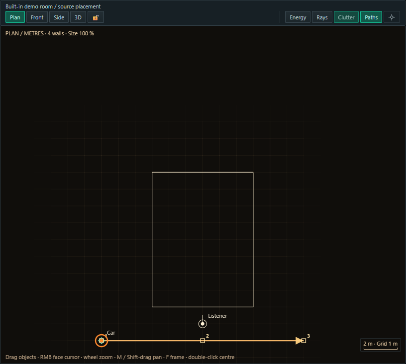

   *Знімок браузерного стенда з тестовою геометрією. Авто їде помаранчевою траєкторією, слухач розташований біля фасаду.*

2. **Від пульта диригента до шостого ряду.** Завантаж VSL Grand Hall Conductor, щоб почати з місця диригента. Джерела на сцені залиш нерухомими. Намалюй шлях слухача від подіуму до вибраної точки в зоні глядачів. «Шостий ряд» тут лише ілюстрація: у пресетах немає місць чи пронумерованих рядів. Наприклад, використай три точки, початкову висоту вух 1,9 м, кінцеву сидячи 1,2 м і п’ятисекундну огинаючу **Listener Path position**. Звір висоти в сцені й проклади шлях поза поверхнями. Щоб задати висоту Z, вибирай вузли по одному в редакторі траєкторії. Окремий пресет Audience дає фіксовану позицію в залі. Запечи єдину траєкторію слухача після налаштування виходу та маршрутизації.

   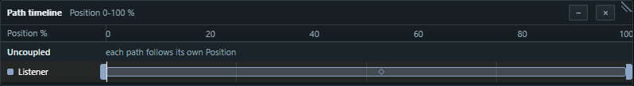

   *Знімок браузерного стенда з триточковим шляхом слухача в тестовій геометрії. На шкалі показано Position. П’ятисекундна огинаюча задається в REAPER.*

3. **Голос і слухач у русі.** Задай три точки для голосу на відрізку близько 4 м і три для слухача на відрізку близько 3 м. Додай обидві ввімкнені траєкторії до **Group 1**, установи **Start %** слухача на 25 і залиш **End %** на 100. Якщо голос — Source 1, його Path position керує обома. Проведи огинаючу за чотири секунди. Вибери **Manual** і профіль **Human Voice · Sentence (TH Köln)** у **Instrument**, потім автоматизуй **Source 1 Azimuth** від −30° до +60°. Запечи групу й окремо порівняй **Tail**, **Direct** та **Early**. Поточний поворот чути в прямому й ранньому компонентах.

   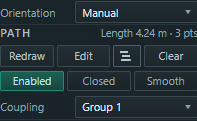

   *Знімок браузерного стенда з тестовими траєкторіями. Порівняй різні початки руху на [шкалі групи](#movement).*

4. **Запис автоматизації DAW.** Вимкни траєкторію монофонічного джерела й автоматизуй **Source 1 X** від 1 м до 5 м за дві секунди зі сталими Y і Z. За бажанням додай слухачеві незалежну огинаючу Y. Натисни **Record automation**, один раз програй огинаючі й натисни **Stop** у плагіні. Перевір виділену підказку й натисни **Bake path**. Повтори ті самі огинаючі. Якщо зміниш їх, стеж за `Live motion is outside the baked recording - estimating the tail`.

<a name="bake-faq"></a>

### Запитання про запікання

- **Bake нічого не робить або стоїть на 0%.** Прочитай причину. Перевір, чи ввімкнено траєкторію або чи **Recorded** показує готовий прохід. Заверши правки кімнати, припини переміщувати курсор і дочекайся перебудови. Починаючи з 0.2.3, після правки чи заміни кімнати запікання працює із зупиненим транспортом. Якщо в малій замкненій кімнаті трасування так і не стартує, повідом точний напис і попередні дії.
- **Постійно Outdated.** Перевір, чи змінюються геометрія, розмір, поглинання, якість, маршрути або пози нерухомих учасників. Вибери остаточні налаштування перед запіканням. Після відкриття проєкту чи пресета перевір, з якої збірки таблиця. Для запису звір, чи відповідає він руху.
- **Хвіст змінюється після зупинки руху.** Одне точне оновлення в усталеній позі очікуване. У замірі однієї тестової сцени зміна в широкій смузі дала близько **+0,4 дБ** з обома способами запікання і **−8,6 дБ** без запікання. Ці числа стосуються конкретної сцени й заміру. Якщо зі зробленим Bake перехід різкий, перевір, чи таблиця застосовується та який статус записаного проходу.
- **Запечений хвіст не повертається за азимутом.** Без ключів азимуту таблиця використовує кут на час запікання намальованого шляху або кути захопленого проходу, тоді як прямий звук і ранні відбиття слідують за живим кутом (без скидання таблиці в Manual). Щоб запечений хвіст теж слідував за запланованим поворотом на траєкторії, додай **Ключі азимуту** перед запіканням.
- **Запікання дуже повільне.** Час запікання зростає з розміром кімнати. На практиці кімнати, зібрані з об’ємів, що перекриваються або не з’єднані, запікаються помітно довше, тому, якщо кімната має бути замкненою, перевір стики кутів і ненавмисні отвори. Великі сцени, високий бюджет променів, багато виходів і завантажений CPU можуть збільшити час. Для перевірки налаштувань спробуй **Preview**, а для міксу запечи з остаточною якістю.
- **Як очистити чи замінити запікання або запис?** **Discard** видаляє запис і його таблиці. **Clear bake** прибирає таблиці й зберігає шляхи та запис. **Cancel** зупиняє запікання. **Bake again** розраховує нову таблицю після правки.
- **Чи обов’язково запікати?** Статичну кімнату відтворюй звичайно. Для рухомої сцени спершу послухай поточну оцінку і запікай, якщо хвіст має точніше слідувати за рухом.

<a name="presets"></a>

## 9. Пресети й обмін

Кнопка **Save** зберігає повний `.verbroom`, а **Load file** відкриває його. Файл містить геометрію, матеріали, налаштування джерел і слухача, траєкторії, параметри міксу, конфігурацію виходу, якість хвоста й придатні для збереження запечені таблиці. Користувацька бібліотека лежить у каталозі документів `SBP/Verb Room/Rooms`. Збережені пресети з’являються в меню кімнат. Проєкт хоста зберігає доріжки, sends, матрицю пінів, огинаючі та налаштовані екземпляри інструментів. Бібліотеки семплів потрібні окремо.

Серед вбудованих варіантів є **Chamber hall - audience, row 6 (chamber orchestra)** і VSL Grand Hall із позицією **audience** (в залі) та **conductor** (на подіумі). Завантажувані пакети також містять файли VSL Grand Hall Audience і Conductor. Обидва використовують 32 стереогрупи на входах 1–64 в одному залі з різними позиціями слухача. Вимкни **Keep I/O**, щоб завантажити всю маршрутизацію. Залиш його ввімкненим, щоб спробувати іншу кімнату зі своїми форматами джерел, входами й форматом виходу. Пози й параметри міксу імпортуються за індексом джерела. Див. [посібник із пресетів](Presets_0.1.10_uk.md) і [маршрутизацію оркестру](Orchestra_presets.md).

**Load file** також відкриває старі сцени `.txt`. Вони описують геометрію. Налаштуй джерела, маршрутизацію та мікс у плагіні й збережи `.verbroom` для повного обміну. Старі `.verbroom` і проєкти продовжують завантажуватися. Після відкриття перевір статус запікання. Повторний вибір вбудованої кімнати завантажує її типові налаштування з поточної версії. Перед обміном перевір, чи немає випадкових **Mute** або Solo, і відкрий пресет у новому екземплярі.

**Export IR** створює статичні 32-бітні імпульсні відповіді WAV із рухомою комою, по одному файлу на точку рушія, і текстовий опис кімнати. Перед експортом задай потрібні позиції слухача й джерел. Це знімок модельованої відповіді. Канал LFE не входить до експорту. Щоб передати редагований рух, збережи пресет або проєкт.

<a name="performance"></a>

## 10. Налаштування і продуктивність

- У **Output / microphones** є **Layout**, **Microphones**, **Show microphone array to scale** (показати приймачі в масштабі) та **Radius**. Під час налаштування об’ємного звуку перевір **Rendered / host** і вихідні індикатори.
- У **Tail · convolution** є **Quality**, **Tail rays** і **Adaptive**. **Preview · 12,000**, **Mix · 48,000** та **Render · 192,000** задають базову кількість променів. **Tail rays** налаштовує її вручну (8000–384000). Для решти значень меню **Quality** показує **Custom**. **Adaptive** дозволяє уточнення в межах бюджету. Зміна якості може зробити таблицю застарілою.
- У **Physics** є **Edge diffraction** (дифракція на краях). У **Array / host** є **Keep processing during silence** (обробляти під час тиші), типово вимкнений. REAPER може припинити виклики плагіна без вхідного сигналу після заявленого хвоста. Інший варіант у REAPER — **Compatibility settings → Ignore plug-in reported tail size**.
- У **Theme** є **Accent** (акцент), **Background tint** (відтінок фону), **Tint strength** (його сила), палітри сцени й кольори окремих елементів, **Energy palette** і **Material-class colours instead of theme roles** (кольори за класами матеріалів). **Mouse wheel changes values (Alt+wheel always does)** типово вимкнено, щоб прокручування не змінювало значення. **Classic UI** є в **Theme** на платформах із підтримкою нового інтерфейсу.

Для великих сесій використовуй **Physical**, особливо з AmbiX третього порядку. Під час монтажу спробуй нижчий бюджет променів, а перед остаточним запіканням поверни якість міксу. Залиши запас часу на обробку блоку й перевір звук на частоті дискретизації проєкту. Якщо відтворення переривається, збільш буфер аудіопристрою в REAPER і повтори. За 48 кГц тривалість блоку з 128 семплів — близько 2,7 мс, з 1024 — близько 21 мс. Ці числа описують тривалість блоків. У 0.2.2 повтор того самого записаного проходу перевірено з різними розмірами блока. Після зміни частоти дискретизації дочекайся перебудови й перевір статус запікання.

<a name="troubleshooting"></a>

## 11. Усунення проблем і відомі обмеження

| Симптом | Що перевірити |
| --- | --- |
| REAPER не знаходить Verb Room | Скопіюй увесь пакет у каталог VST3, який сканує REAPER, і проскануй знову. Перевір ОС, архітектуру й підтримку AVX2/FMA для типової збірки Windows. |
| Немає звуку або частини каналів | Простеж сигнал від кліпу та send до вхідних пінів FX, **In** і **Format**, потім до вихідних пінів FX і виходу шини. Перевір Mute, Solo, **Mix**, **Layout** і **Rendered / host**. Почни з одного робочого входу та стереовиходу. |
| У Windows відкривається класичний редактор | Перевір WebView2 Runtime і збережений вибір редактора. **New UI** з’являється, коли новий редактор доступний. **Diagnostics** у **Theme** показує дані вебредактора, якщо він відкривається. |
| macOS блокує завантажений пакет | Пакет підписано ad-hoc, без нотаризації. Для довіреного завантаження проєкту спробуй **Open** у Finder або зніми карантин із відповідного пакета. У команді нижче вкажи фактичний шлях. |
| Linux не сканує плагін | Перевір шлях VST3 і сумісність бібліотек. Збірка для Ubuntu 24.04 потребує glibc 2.39 або новішої та використовує класичний редактор. |
| Комбінації клавіш хоста не працюють у вебредакторі macOS | Клацни поза редактором перед використанням комбінацій хоста. |

```sh
xattr -dr com.apple.quarantine "$HOME/Library/Audio/Plug-Ins/VST3/Verb Room.vst3"
```

Якщо джерел більше ніж чотири, ранні відбиття під час руху оновлюються порціями з плавними переходами. Геометрія **2,5D** складається з вертикальних стін і горизонтальних поверхонь. Модель не охоплює низькочастотні хвильові моди. Пізній хвіст є статистичною оцінкою, а Energy показує модельоване покриття за одиничного збудження. Сприймай покази як діагностику моделі й прослуховуй сцену в сесії.

Windows перевіряли в REAPER (включно з 64-канальною вихідною шиною в 0.3.1 і прив’язкою `Mod Out` у 0.3.0). Учасник спільноти перевірив 0.2.0 на реальному Mac. Версії 0.2.1–0.3.1 ще чекають на перевірку на Mac. Linux збирається й проходить тести CI з класичним інтерфейсом. Перевірка в реальному хості ще попереду. Продуктивність у реальних сесіях на старіших чотириядерних машинах потребує перевірки. Див. [нотатки 0.3.1](Release_0.3.1_uk.md).

<a name="reporting"></a>

## 12. Як повідомити про проблему

Укажи версію Verb Room і редактор, ОС, CPU, DAW та її версію, частоту дискретизації, розмір блока, маршрутизацію, формат виходу й кімнату або доступний для поширення `.verbroom`. Для запікання додай точний напис банера, порядок натискання кнопок, стан транспорту і спосіб руху: намальовані шляхи чи запис. Для автоматизації додай огинаючі або мінімальний проєкт, у якому видно проблему. [Повідомити про проблему на GitHub](https://github.com/Bodzijun/sbp-verb-room/issues).

Verb Room поширюється за **AGPL-3.0** і використовує JUCE за умовами AGPLv3. Вбудовані виміряні профілі мають атрибуцію **CC BY 4.0**. [Ліцензія](https://github.com/Bodzijun/sbp-verb-room/blob/main/LICENSE) · [Атрибуція профілів](../THIRD_PARTY_DIRECTIVITY.md) · [Сторінка проєкту](https://bodzijun.github.io/sbp-verb-room/) · [Підтримати на Ko-fi](https://ko-fi.com/s/405ebacfcc).

<a name="glossary"></a>

## 13. Словник

| Термін | Значення |
| --- | --- |
| **Physical / Creative** | Режими відтворення моделі кімнати та застосування творчих поправок. |
| Ранні відбиття | Перші окремі відбиті шляхи від джерела до слухача. |
| Пізній хвіст | Щільна реверберація після ранніх відбиттів, яку рушій моделює статистично. |
| RT60 | Оцінений час спаду рівня звукової енергії на 60 дБ. |
| Спрямованість | Те, як джерело випромінює або приймач реагує в різних напрямках. |
| AmbiX | Амбісонічний вихід із порядком ACN і нормалізацією SN3D. |
| Group | Увімкнені траєкторії зі спільним параметром Position. |
| Траєкторія | Редагована крива руху та її часові параметри. |
| **Модуляція руху** | Creative-маршрутизація просторових/кінематичних драйверів через криві до по-джерельних або глобальних цілей. |
| **Path LFO** | Вбудований низькочастотний осцилятор (`0.05–8 Hz`), що модулює **Position** уздовж траєкторії в режимі Creative. |
| Запікання | Попередній розрахунок таблиці пізнього хвоста для подальшого відтворення руху. |
| Записаний прохід | Пози, захоплені під час відтворення DAW й доступні рушію для запікання. |
| Усталення | Поза достатньо довго стабільна, тож рушій планує точну перебудову хвоста. |
