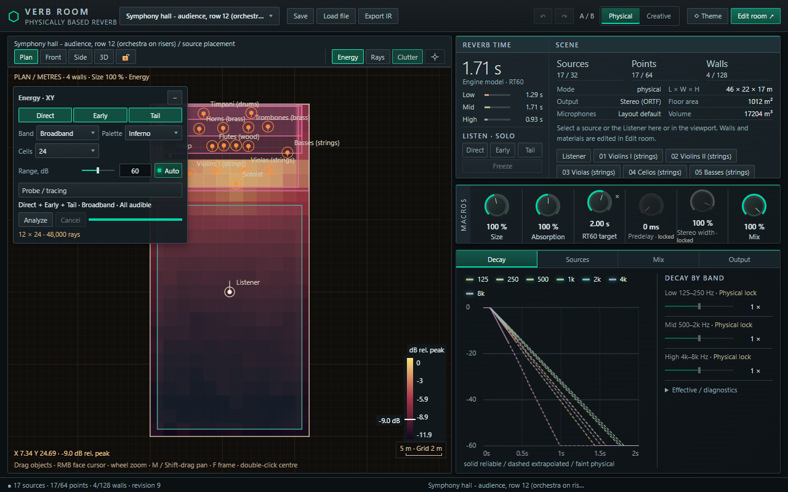
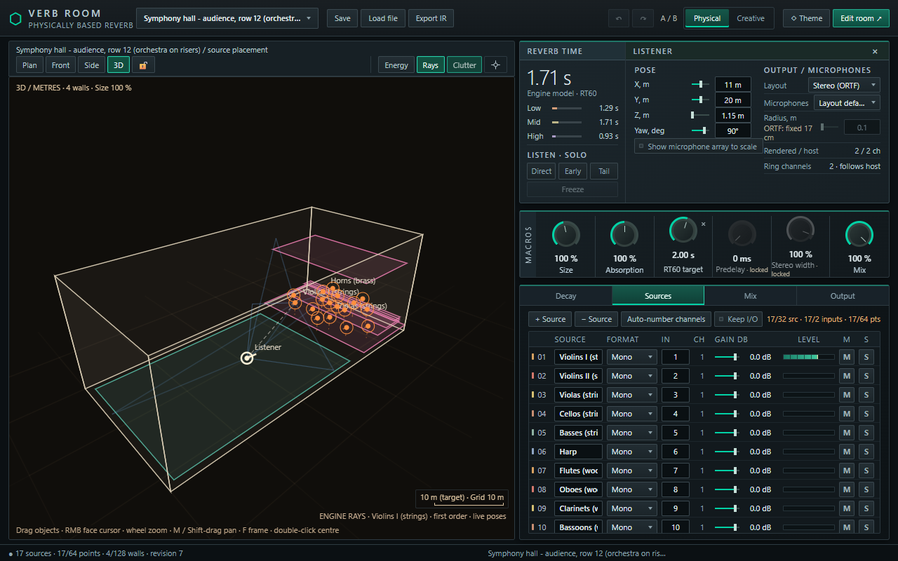
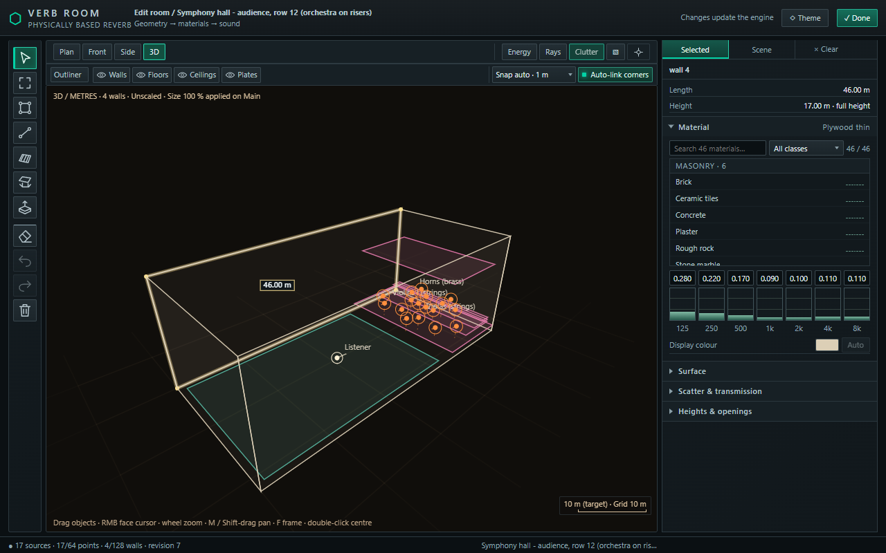

# Verb Room — road to 1.0

*Status: draft for discussion, November 2026. Nothing here is a promise of dates.*

Verb Room is a free, open-source (AGPL-3.0) room reverb for VST3 hosts. You draw a room, put sound sources and a
listener into it, and the plug-in computes how that room sounds at that spot — and keeps recomputing while things move.
This page explains how it works, what makes it different, where it is going, and how you can help.

## How the engine works

The plug-in does not play back a recorded impulse response and does not use a "hall" algorithm with decay knobs.
It simulates sound propagation in the geometry you give it, separately in seven octave bands (125 Hz – 8 kHz):

1. **The room** is a set of wall segments with heights, floor and ceiling zones, and horizontal plates (a table, a
   balcony, a car bonnet). Every surface has a material: absorption, scattering and sound transmission per band.
2. **Direct sound and early reflections** are found exactly, with the image-source method: for each source and each
   microphone the engine finds the mirror paths, checks that nothing blocks them, and plays each path as its own
   delay with its own filtering. Sound that passes through a thin wall is attenuated by that wall; sound that goes
   round a wall end is diffracted.
3. **The late tail** is ray-traced: thousands of rays are followed through the room, their energy is collected at the
   listener over time, and the result becomes the reverberant tail. The tail is rendered by a zero-latency
   convolution and is re-traced in the background when the scene changes.
4. **Movement is part of the model.** Positions and directions of every source and of the listener are automatable
   parameters. Path delays glide, so Doppler is the physical one, not an effect added on top.

Up to 32 sources (mono to 7.1, each channel with its own position) feed one room; the listener can be anything from
mono to 7.1.4, with microphone patterns or a human-ears model.

## What is different from other reverbs

| | Algorithmic reverb | Convolution reverb | Verb Room |
|---|---|---|---|
| Where the sound comes from | a designed network of delays | a recording of one place | a simulation of the room you drew |
| Source and listener position | pan / width / "distance" controls | fixed at recording time | real positions, per source, automatable |
| Many sources in one space | each gets the same reverb | each gets the same reverb | each gets its own reflections and its own share of the tail |
| Obstacles, doors, a second room | not modelled | whatever was recorded | modelled: occlusion, transmission, diffraction |
| Changing the room | turn knobs | load another file | move a wall, change a material |
| Movement | not modelled | not possible | paths follow the movement, physical Doppler |

Two modes keep this honest: in **Physical** the room sounds as modelled and the "taste" controls are locked;
**Creative** unlocks the overrides (decay per band, early/tail level, size, pre-delay, width, ducking, freeze).

It also shows you what it computes: reflection paths in the viewport, decay curves per band, and an energy map of
the room.

**What it is not (yet).** The geometry is 2.5D (vertical walls, horizontal floors, ceilings and plates). It is
geometrical acoustics: there are no low-frequency room modes. The tail is a statistical estimate. Big scenes are heavy
on the CPU. It is alpha software developed and tested mainly in REAPER on Windows; macOS and Linux builds exist but
need testers.

## Where we are

**Released: 0.1.16** (classic interface) — smoother late tail, Physical / Creative modes, absorption scale and an
RT60 target assistant, editor improvements. Windows, macOS (universal) and Linux packages.

**Built and in testing for the next version:**

- A new interface: resizable, with a 3D room editor, material inspector, dimensions and scale, CPU load meter.
- New creative controls: Size, Pre-delay, Stereo width, Ducking, and a Freeze that really holds the tail.
- Engine fixes: a sealed room is now really sealed (no sound leaking through closed corners or through walls into the
  tail), correct tail level near walls, bounded real-time cost of the diffraction search.

*The new interface (in testing): energy map of a symphony hall, decay curves per band, room size.*

*3D view with reflection paths from the engine, the listener settings and the source list.*

*Room editor: a selected wall with its length, height and material.*

## Road to 1.0

We would like to call the next major version 1.0 when the following is in place. Order may change.

**1. Movement that sounds right (in progress)**
- Smooth changes while the listener or a source moves; one accurate update when it stops.
- Soft shadow edges for reflected sound and for horizontal edges (a bonnet, a table), so sound does not appear in steps
  when you come round a corner.
- Repeatable offline render: two bounces of the same project are identical.
- Later: pre-computed ("baked") tails along an automated path.

**2. Lower CPU for big scenes**
- Spreading the convolution work evenly across audio blocks.
- A hybrid tail: ray-traced beginning, efficient feedback network for the long end.

**3. More automation**
- Automatable reflection controls (absorption per band, scattering).
- Automation slots for materials: assign a slot to a material or a group of surfaces and automate it.

**4. More realism**
- Instrument and loudspeaker directivity from user-supplied data files.
- Directional tail, binaural and Ambisonics output.
- Low-frequency room modes.

**5. Product basics**
- The new interface on macOS and Linux; stable automated tests on all three platforms.
- Installers, signing, a manual, more ready-made rooms.
- Other plug-in formats (CLAP, AU) if there is demand.

## How you can help

- **Test and report.** Other hosts than REAPER, macOS and Linux, large sessions, odd buffer sizes. A bug report with
  the `.verbroom` preset attached is worth ten without.
- **Share rooms.** Presets of real or imagined spaces; measured rooms to compare the model against are especially
  welcome.
- **Tell us what you need.** Feature requests in the issues decide the order of this roadmap — the material
  automation item above came from one.
- **Contribute.** The engine is plain C++17 with tests; the interface is plain JavaScript. Build instructions are in
  the README.
- **Support development.** Verb Room is written by one person together with AI coding agents. The agents write and
  test most of the code, and their usage limits are the main thing that slows the project down: work regularly stops
  for hours until a limit resets. Donations go to agent credits, which translate directly into fixes and features.
  Donate: [ko-fi.com/bohdan_sbp](https://ko-fi.com/bohdan_sbp).

Questions and ideas: GitHub issues of the project.
