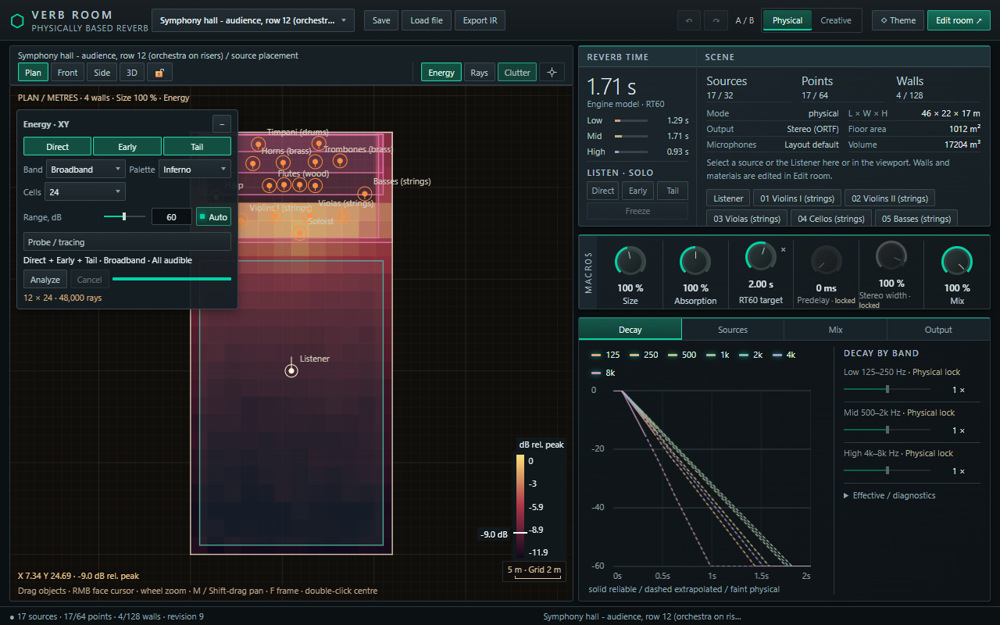
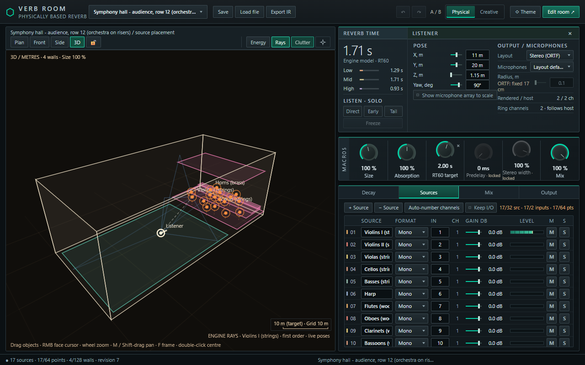
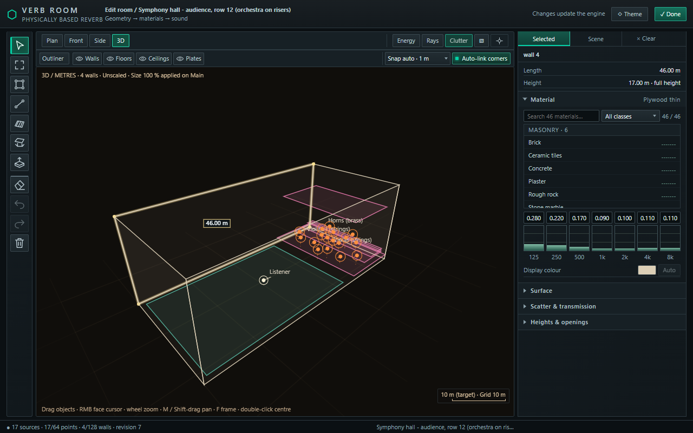

# Verb Room — шлях до версії 1.0

*Статус: чернетка для обговорення, листопад 2026. Жодних обіцянок щодо термінів тут немає.*

Verb Room — безкоштовний ревербератор кімнати з відкритим кодом (AGPL-3.0) для VST3-хостів. Ви малюєте кімнату,
ставите в неї джерела звуку і слухача, а плагін обчислює, як ця кімната звучить у цій точці, і перераховує це,
поки все рухається. Тут описано, як він працює, чим відрізняється, куди рухається і як можна допомогти.

## Як працює рушій

Плагін не відтворює записаний імпульс і не використовує алгоритм «зали» з ручками спаду. Він моделює поширення звуку
в заданій геометрії, окремо в семи октавних смугах (125 Гц – 8 кГц):

1. **Кімната** — це відрізки стін із висотами, зони підлоги й стелі та горизонтальні плити (стіл, балкон, капот
   машини). Кожна поверхня має матеріал: поглинання, розсіювання і пропускання звуку по смугах.
2. **Прямий звук і ранні відбиття** знаходяться точно, методом уявних джерел: для кожного джерела і кожного мікрофона
   рушій шукає дзеркальні шляхи, перевіряє, що їх нічого не перекриває, і відтворює кожен шлях власною затримкою з
   власною фільтрацією. Звук, що проходить крізь тонку стіну, послаблюється цією стіною; звук, що огинає край стіни,
   дифрагує.
3. **Пізній хвіст** рахується трасуванням променів: тисячі променів проходять кімнатою, їхня енергія збирається в
   точці слухача в часі, і з цього будується реверберація. Хвіст відтворюється згорткою без затримки і
   перетрасовується у фоні, коли сцена змінюється.
4. **Рух — частина моделі.** Положення й напрямки кожного джерела і слухача — параметри, які можна автоматизувати.
   Затримки шляхів змінюються плавно, тому ефект Доплера тут фізичний, а не доданий зверху.

До 32 джерел (від моно до 7.1, кожен канал зі своїм положенням) звучать в одній кімнаті; слухач — від моно до 7.1.4,
з характеристиками мікрофонів або з моделлю людських вух.

## Чим він відрізняється від інших ревербераторів

| | Алгоритмічний | Згортковий | Verb Room |
|---|---|---|---|
| Звідки береться звук | спроєктована мережа затримок | запис одного місця | модель кімнати, яку ви намалювали |
| Положення джерела і слухача | ручки панорами / ширини / «відстані» | зафіксоване під час запису | справжні положення, для кожного джерела, з автоматизацією |
| Багато джерел в одному просторі | усі отримують однакову реверберацію | усі отримують однакову реверберацію | кожне має свої відбиття і свою частку хвоста |
| Перешкоди, двері, сусідня кімната | не моделюються | лише те, що записано | моделюються: затінення, пропускання, дифракція |
| Зміна кімнати | крутити ручки | завантажити інший файл | пересунути стіну, змінити матеріал |
| Рух | не моделюється | неможливий | шляхи йдуть за рухом, фізичний Доплер |

Два режими тримають це чесним: у **Physical** кімната звучить так, як змодельована, а «смакові» ручки заблоковані;
**Creative** відкриває перекриття (спад по смугах, рівень ранніх відбиттів і хвоста, розмір, передзатримка, ширина,
дакінг, заморожування).

Плагін також показує, що саме він рахує: шляхи відбиттів у в'юпорті, криві спаду по смугах і мапу енергії кімнати.

**Чим він (поки) не є.** Геометрія 2.5D: вертикальні стіни, горизонтальні підлоги, стелі та плити. Це геометрична
акустика: низькочастотних мод кімнати немає. Хвіст — статистична оцінка. Великі сцени важкі для процесора. Це
альфа-версія, яка розробляється і перевіряється переважно в REAPER на Windows; збірки для macOS і Linux є, але
потребують тестувальників.

## Де ми зараз

**Випущено: 0.1.16** (класичний інтерфейс) — плавніший пізній хвіст, режими Physical / Creative, шкала поглинання і
помічник цільового RT60, покращення редактора. Пакети для Windows, macOS (universal) і Linux.

**Зроблено і тестується для наступної версії:**

- Новий інтерфейс: зі зміною розміру, 3D-редактором кімнати, інспектором матеріалів, розмірами й масштабом,
  індикатором навантаження процесора.
- Нові творчі ручки: Size, Pre-delay, Stereo width, Ducking і Freeze, який справді утримує хвіст.
- Виправлення рушія: закрита кімната тепер справді закрита (звук не просочується крізь закриті кути чи крізь стіни у
  хвіст), правильний рівень хвоста біля стін, обмежена вартість пошуку дифракції в реальному часі.

*Новий інтерфейс (тестується): мапа енергії симфонічної зали, криві спаду по смугах, розміри кімнати.*

*3D-вигляд зі шляхами відбиттів із рушія, настройки слухача і список джерел.*

*Редактор кімнати: виділена стіна з довжиною, висотою і матеріалом.*

## Шлях до 1.0

Наступну велику версію хочемо назвати 1.0, коли буде готове таке. Порядок може змінитись.

**1. Рух, який звучить правильно (в роботі)**
- Плавні зміни, поки слухач або джерело рухається; одне точне оновлення після зупинки.
- М'які межі тіні для відбитого звуку і для горизонтальних країв (капот, стіл), щоб звук не з'являвся сходинками,
  коли виходиш з-за кута.
- Відтворюваний офлайн-рендер: два баунси одного проєкту однакові.
- Пізніше: заздалегідь обчислені («запечені») хвости вздовж автоматизованої траєкторії.

**2. Менше навантаження на процесор у великих сценах**
- Рівномірний розподіл роботи згортки між звуковими блоками.
- Гібридний хвіст: початок із трасування променів, довгий кінець — ефективна мережа зі зворотним зв'язком.

**3. Більше автоматизації**
- Ручки відбиття з автоматизацією (поглинання по смугах, розсіювання).
- Слоти автоматизації матеріалів: призначаєте слот матеріалу або групі поверхонь і автоматизуєте його.

**4. Більше реалізму**
- Спрямованість інструментів і гучномовців із файлів даних користувача.
- Спрямований хвіст, бінауральний та Ambisonics-вихід.
- Низькочастотні моди кімнати.

**5. Основи продукту**
- Новий інтерфейс на macOS і Linux; стабільні автоматичні тести на всіх трьох платформах.
- Інсталятори, підпис, посібник, більше готових кімнат.
- Інші формати плагінів (CLAP, AU), якщо буде попит.

## Як допомогти

- **Тестуйте і повідомляйте.** Інші хости, крім REAPER, macOS і Linux, великі сесії, незвичні розміри буфера.
  Повідомлення про помилку з доданим пресетом `.verbroom` варте десяти без нього.
- **Діліться кімнатами.** Пресети справжніх чи вигаданих просторів; особливо цінні виміряні кімнати, з якими можна
  порівняти модель.
- **Кажіть, що вам потрібно.** Запити в ішью визначають порядок цієї дорожньої карти: пункт про автоматизацію
  матеріалів з'явився саме з такого запиту.
- **Долучайтесь до коду.** Рушій — звичайний C++17 із тестами, інтерфейс — звичайний JavaScript. Інструкції зі
  збірки є в README.
- **Підтримайте розробку.** Verb Room пише одна людина разом з AI-агентами для програмування. Агенти пишуть і
  тестують більшість коду, і саме їхні ліміти використання найбільше гальмують проєкт: робота регулярно зупиняється
  на години, доки ліміт не скинеться. Донати йдуть на кредити для агентів, тобто прямо на виправлення і нові
  можливості. Підтримати: [ko-fi.com/bohdan_sbp](https://ko-fi.com/bohdan_sbp).

Питання та ідеї — в ішью проєкту на GitHub.
