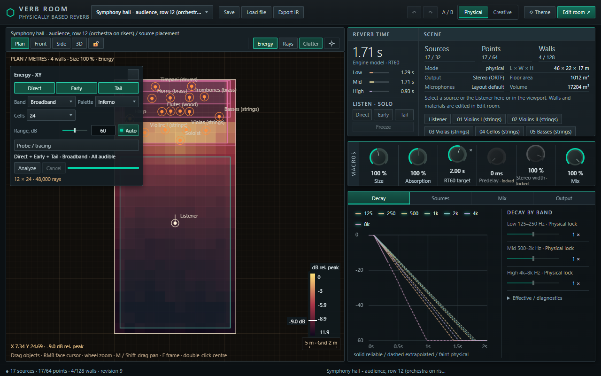
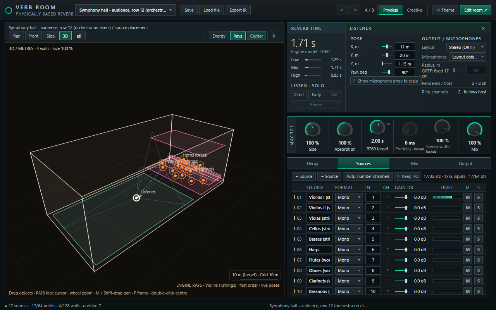
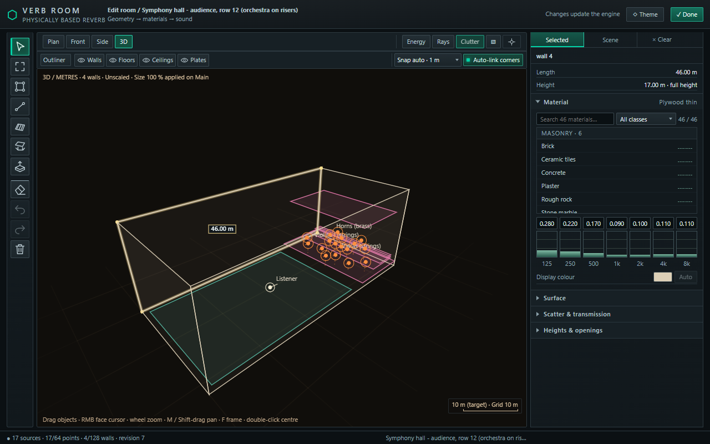

# Verb Room — шлях до версії 1.0

*Статус: чернетка для обговорення, листопад 2026. Жодних обіцянок щодо термінів тут немає.*

Verb Room — безкоштовний ревербератор кімнати з відкритим кодом (AGPL-3.0) для VST3-хостів. Ви малюєте кімнату,
ставите в неї джерела звуку і слухача, а плагін обчислює, як ця кімната звучить у цій точці, і перераховує це,
поки все рухається. Тут описано, як він працює, чим відрізняється, куди рухається і як можна допомогти.

## Як працює рушій

Плагін не відтворює записаний імпульс і не використовує алгоритм «зали» з ручками спаду. Він моделює поширення звуку
в заданій геометрії, окремо в семи октавних смугах (125 Гц – 8 кГц):

1. **Кімната** — це відрізки стін із висотами, зони підлоги й стелі та горизонтальні плити (стіл, балкон, капот
   машини). Кожна поверхня має матеріал: поглинання, розсіювання і пропускання звуку по смугах.
2. **Прямий звук і ранні відбиття** знаходяться точно, методом уявних джерел: для кожного джерела і кожного мікрофона
   рушій шукає дзеркальні шляхи, перевіряє, що їх нічого не перекриває, і відтворює кожен шлях власною затримкою з
   власною фільтрацією. Звук, що проходить крізь тонку стіну, послаблюється цією стіною; звук, що огинає край стіни,
   дифрагує.
3. **Пізній хвіст** рахується трасуванням променів: тисячі променів проходять кімнатою, їхня енергія збирається в
   точці слухача в часі, і з цього будується реверберація. Хвіст відтворюється згорткою без затримки і
   перетрасовується у фоні, коли сцена змінюється.
4. **Рух — частина моделі.** Положення й напрямки кожного джерела і слухача — параметри, які можна автоматизувати.
   Затримки шляхів змінюються плавно, тому ефект Доплера тут фізичний, а не доданий зверху.

До 32 джерел (від моно до 7.1, кожен канал зі своїм положенням) звучать в одній кімнаті; слухач — від моно до 7.1.4,
з характеристиками мікрофонів або з моделлю людських вух.

## Чим він відрізняється від інших ревербераторів

| | Алгоритмічний | Згортковий | Verb Room |
|---|---|---|---|
| Звідки береться звук | спроєктована мережа затримок | запис одного місця | модель кімнати, яку ви намалювали |
| Положення джерела і слухача | ручки панорами / ширини / «відстані» | зафіксоване під час запису | справжні положення, для кожного джерела, з автоматизацією |
| Багато джерел в одному просторі | усі отримують однакову реверберацію | усі отримують однакову реверберацію | кожне має свої відбиття і свою частку хвоста |
| Перешкоди, двері, сусідня кімната | не моделюються | лише те, що записано | моделюються: затінення, пропускання, дифракція |
| Зміна кімнати | крутити ручки | завантажити інший файл | пересунути стіну, змінити матеріал |
| Рух | не моделюється | неможливий | шляхи йдуть за рухом, фізичний Доплер |

Два режими тримають це чесним: у **Physical** кімната звучить так, як змодельована, а «смакові» ручки заблоковані;
**Creative** відкриває перекриття (спад по смугах, рівень ранніх відбиттів і хвоста, розмір, передзатримка, ширина,
дакінг, заморожування).

Плагін також показує, що саме він рахує: шляхи відбиттів у в'юпорті, криві спаду по смугах і мапу енергії кімнати.

**Чим він (поки) не є.** Геометрія 2.5D: вертикальні стіни, горизонтальні підлоги, стелі та плити. Це геометрична
акустика: низькочастотних мод кімнати немає. Хвіст — статистична оцінка. Великі сцени важкі для процесора. Це
альфа-версія, яка розробляється і перевіряється переважно в REAPER на Windows; збірки для macOS і Linux є, але
потребують тестувальників.

## Де ми зараз

**Остання випущена версія: [0.3.0](Release_0.3.0_uk.md)** для Windows x64, macOS Universal і Linux x86_64. Пакети публікуються на [сторінці проєкту в Ko-fi](https://ko-fi.com/s/405ebacfcc).

- **Новий інтерфейс:** зі зміною розміру, 3D-редактором кімнати, інспектором матеріалів, розмірами й масштабом,
  структурою сцени, кривими спаду, мапою енергії, ключами азимуту на таймлайні, інтерактивним редактором модуляції, згортаними секціями інспектора, вікном About та індикатором навантаження процесора. Класичний інтерфейс
  лишається доступним. На macOS новий інтерфейс вийшов у 0.2.0 і потребує тестувальників на 0.2.1–0.3.0.
- **Траєкторії руху:** малюєте шлях для джерела або слухача й автоматизуєте один параметр позиції. Таймінг шляху
  (старт / кінець, час точки, плавність), кола й замкнені шляхи, групи, що рухаються разом, орієнтація (вздовж шляху
  або дивитися на інший об'єкт, також між рухомими об'єктами), панель таймлайну та **запечені хвости** вздовж шляху,
  які обчислюються у фоні.
- **Ambisonics:** вихід AmbiX 1-го, 2-го і 3-го порядку.
- **Спрямованість джерел** із файлів даних користувача, теки профілів і наведення.
- **Нові творчі ручки:** Size, Pre-delay, Stereo width, Ducking і Freeze, який справді утримує хвіст.
- **Виправлення рушія:** закрита кімната тепер справді закрита (звук не просочується крізь закриті кути чи крізь стіни
  у хвіст), правильний рівень хвоста біля стін, обмежена вартість пошуку дифракції в реальному часі, плавніший пізній
  хвіст.
- **Автоматизація позиції крізь тишу:** необов'язковий режим «продовжувати обробку».

*Новий інтерфейс (тестується): мапа енергії симфонічної зали, криві спаду по смугах, розміри кімнати.*

*3D-вигляд зі шляхами відбиттів із рушія, настройки слухача і список джерел.*

*Редактор кімнати: виділена стіна з довжиною, висотою і матеріалом.*

## Шлях до 1.0

Наступну велику версію хочемо назвати 1.0, коли буде готове таке. Порядок може змінитись.

**1. Рух, який звучить правильно (здебільшого зроблено в 0.2.0)**
- Плавні зміни, поки слухач або джерело рухається; одне точне оновлення після зупинки.
- М'які межі тіні для відбитого звуку і для горизонтальних країв (капот, стіл), щоб звук не з'являвся сходинками,
  коли виходиш з-за кута.
- Плавна передача відбиттів там, де поверхні стикуються (капот із кузовом, кути стін).
- Відтворюваний офлайн-рендер: два баунси одного проєкту однакові.
- Траєкторії руху: малюєте шлях для джерела або слухача у в'юпорті й автоматизуєте один параметр «позиція на
  шляху» замість окремих X/Y/Z (запит тестувальника). **Зроблено в 0.2.0** разом із заздалегідь обчисленими
  («запеченими») хвостами вздовж шляху, таймінгом, групами та орієнтацією.
- Ручний поворот об'єкта (орієнтація Manual) більше не ламає бейк. **Зроблено в 0.2.2** для групових бейків і для
  записаного проходу: для Manual-об'єктів запечена таблиця більше не вимагає збігу азимута (позиція все одно має
  збігатися). Прямий звук і ранні відбиття слідують за живим азимутом, а запечений хвіст зберігає азимут, з яким його
  запікали.
- **Зроблено в 0.3.0.** Ключі азимута на таймлайні: смуга азимута кожного об'єкта поруч зі смугою руху, жорстко прив'язана до тієї самої осі
  позиції й тієї самої таблиці. Ключі можна додавати де завгодно, а кут на ключі задавати слайдером або поворотом
  об'єкта в редакторі сцени. Ключі підтримують утримання (hold) і пом'якшення (easing) з найкоротшою дугою через ±180°. Тоді азимут відомий наперед і
  запікається разом зі шляхом, тож запечений хвіст теж слідує за поворотом.
- Ще попереду: орієнтація об'єктів на різких кутах шляху і більше перевірок в інших хостах.

**2. Менше навантаження на процесор у великих сценах**
- Рівномірний розподіл роботи згортки між звуковими блоками.
- Гібридний хвіст: початок із трасування променів, довгий кінець — ефективна мережа зі зворотним зв'язком.

**3. Більше автоматизації**
- Ручки відбиття з автоматизацією (поглинання по смугах, розсіювання).
- **Зроблено в 0.3.0.** Діапазон автоматизації позиції під розмір кімнати: у **Edit room → Scene → Automation range** кнопка **Fit to scene** підганяє межі під стіни, зони, активні джерела, слухача та точки шляхів / огляду із запасом (разом із ручними Min/Max, пунктирною рамкою у сцені, підтвердженням і **Reset (±200 m)** в один крок Undo).
  Типове значення `±200 м` (`0–30 м` по Z) лишається без змін, тому старі проєкти звучать так само.
- **Зроблено в 0.3.0.** Вихідні параметри **`Mod Out 1…16`** (`mo1…mo16`, індекси 283–298) для керування параметрами інших плагінів у DAW (зокрема через `Link from FX parameter` у REAPER) з кривих модуляції (`Host out` / `Host output only`).
- Слоти автоматизації матеріалів: призначаєте слот матеріалу або групі поверхонь і автоматизуєте його.

**4. Більше реалізму**
- Спрямованість інструментів і гучномовців із файлів даних користувача (**зроблено в 0.2.0**).
- Ambisonics-вихід: **AmbiX до 3-го порядку є в 0.2.0**; бінауральний вихід ще попереду.
- Профілі спрямованості діють на прямий звук і ранні відбиття. Пізній хвіст розглядає кожне джерело як
  всеспрямоване; спрямований хвіст на 1.0 не планується.
- **Зроблено в 0.2.3**. Вибір нормалізації Ambisonics. Доступні SN3D (типово), N3D і FuMa.
- **Зроблено в 0.2.3**. Рівень виходу Ambisonics. Доступні 0, −3 і −6 дБ.
- Низькочастотні моди кімнати.

**5. Простіше малювання кімнат**
- Примітив «коробка»: замкнене тіло з чистими стиками для кузовів, колон, меблів.
- Екструд ребер у редакторі (зсув, потім видавлювання), щоб поверхні мали спільні ребра за побудовою.
- Кнопка автоматичного вирівнювання рівня і ширший діапазон виходу для тихих позицій слухача у великих залах.
- **Зроблено в 0.2.2:** кнопка Randomize біля Seed у Clutter; автоз'єднання кутів, коли рухаєш цілу стіну; на панелі
  Sources кнопка Sum для кожного джерела, «All formats…» для формату каналів усіх джерел одразу та ввімкнення чи
  вимкнення Sum для всіх одразу.
- **Зроблено в 0.2.3**. Магніт кутів під час перетягування та Join corners для закриття малих зазорів.
- Після 1.0: повні 3D-сітки з похилими поверхнями.

**6. Основи продукту**
- Новий інтерфейс на macOS (перший випуск у 0.2.0) і Linux; стабільні автоматичні тести на всіх трьох платформах.
- Інсталятори, підпис, посібник, більше готових кімнат.
- Інші формати плагінів (CLAP, AU), якщо буде попит.

**7. Творчі інструменти (кандидати після основ вище)**
- **Модуляція рухом (Зроблено в 0.3.0 для 11 драйверів і 8 звукових цілей + Host output only):** матриця в режимі Creative, у якій рух керує звуком. Реалізовані драйвери: відстань до слухача, до точки чи до найближчої стіни, азимут до слухача, кут підйому, X/Y/Z, 3D-швидкість, радіальна швидкість і позиція на шляху; реалізовані цілі: рівень джерела, фільтри LPF/HPF і полиці джерела, рівень Early / Tail, Wet/dry mix та `Host output only` (через `Mod Out 1–16`), з 2–8-вузловими кривими й згладжуванням атаки/спаду. Драйвер затінення прямого звуку та цілі Doppler, Width, Duck і частка спрямованості лишаються в планах на майбутнє.
- **LFO шляху й орбіти (Path LFO зроблено в 0.3.0):** LFO (`0.05–8 Hz`, Sine/Triangle/Saw/Square/Smooth random) коливає позицію вздовж шляху із синхронізацією транспорту, попередженням краю й кнопкою **Keep inside path**, не інвалідуючи запечені таблиці; прив’язка до темпу хоста, орбіти навколо слухача й обмеження швидкості Doppler лишаються в планах.
- **Анімована геометрія:** двері, люки й стіни, що відчиняються й закриваються на таймлайні (пропускання, висота й
  положення як автоматизація), пов'язані зі слотами автоматизації матеріалів вище.
- **Рій і гранульовані хмари:** джерело, розмножене по об'єму чи поверхні (обмежена кількість голосів для прямого
  звуку й ранніх відбиттів, один спільний хвіст), у русі або з перестановкою по зернах.
- **Реактивна кімната:** рівень вхідного звуку керує розміром, поглинанням чи положенням об'єкта.
- **Зв'язані об'єми:** хвіст сусідньої кімнати, що чути крізь двері.
- **Навчений денойзер хвоста (дослідження):** мала модель, яка чистить шумну оцінку хвоста з небагатьох променів,
  щоб прискорити Preview і Mix; Render лишається повним трасуванням як еталон.

## Як допомогти

- **Тестуйте і повідомляйте.** Інші хости, крім REAPER, macOS і Linux, великі сесії, незвичні розміри буфера.
  Повідомлення про помилку з доданим пресетом `.verbroom` варте десяти без нього.
- **Діліться кімнатами.** Пресети справжніх чи вигаданих просторів; особливо цінні виміряні кімнати, з якими можна
  порівняти модель.
- **Кажіть, що вам потрібно.** Запити в ішью визначають порядок цієї дорожньої карти: пункт про автоматизацію
  матеріалів з'явився саме з такого запиту.
- **Долучайтесь до коду.** Рушій — звичайний C++17 із тестами, інтерфейс — звичайний JavaScript. Інструкції зі
  збірки є в README.
- **Підтримайте розробку.** Verb Room пише одна людина разом з AI-агентами для програмування. Агенти пишуть і
  тестують більшість коду, і саме їхні ліміти використання найбільше гальмують проєкт: робота регулярно зупиняється
  на години, доки ліміт не скинеться. Донати йдуть на кредити для агентів, тобто прямо на виправлення і нові
  можливості. Підтримати: [ko-fi.com/bohdan_sbp](https://ko-fi.com/bohdan_sbp).

Питання та ідеї — в ішью проєкту на GitHub.
